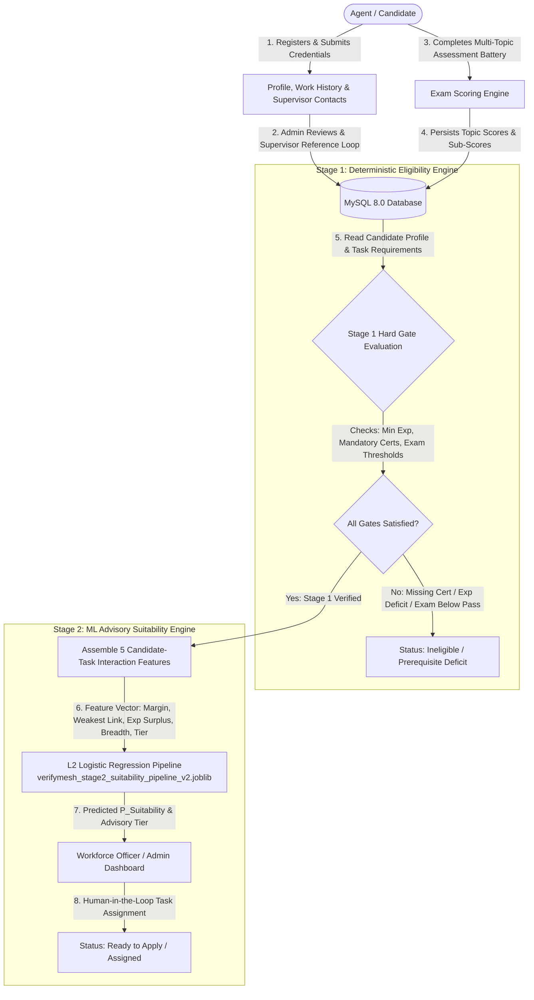

# VerifyMesh: AI-Assisted Workforce Competency & Task Eligibility Engine

**An Intelligent Workforce Qualification Verification and Task Allocation Platform**  
*Undergraduate Computer Science Capstone Project — Chapter 5 System Implementation & Testing*  
*Author:* **Daniel Obuya** | *Institution:* **Strathmore University** | *Repository:* [GitHub](https://github.com/Daniel-Obuya/VerifyMesh)

---

## 1. Executive Summary & Problem Statement

In decentralized workforce platforms, crowdsourcing networks, and distributed labor marketplaces, matching independent workers to high-stakes operational tasks is frequently compromised by **self-reported credential fraud**, **resume embellishment**, and **manual administrative screening bottlenecks**. 

**VerifyMesh** solves this challenge through a **Decoupled Two-Stage Evaluation Architecture**:

1. **Stage 1 — Deterministic Eligibility Engine (Authoritative Gatekeeper):**
   - Cross-references candidate verified attributes against task prerequisites using hard, auditable domain rules:
     - **Tenure Verification:** Administrator- and supervisor-verified experience tenure (in months) must meet or exceed task minimums.
     - **Mandatory Certifications:** All required domain certifications must be verified and active.
     - **Standardized Assessment Battery:** Overall multi-topic exam score must meet the task pass mark.
     - **Topic Competency Floors:** Individual topic scores must satisfy topic-specific minimums (e.g., Communication, Product Knowledge, Sales, Customer Support).
   - Candidates who fail any prerequisite receive a deterministic ineligibility status with transparent remediation feedback. **Ineligible candidates are never overridden by statistical predictions.**

2. **Stage 2 — Machine Learning Task Suitability Advisory Engine:**
   - Evaluates only Stage 1-eligible candidates to predict task-specific success probability $P(\text{Suitability})$.
   - Uses an L2-regularized Logistic Regression pipeline (`StandardScaler` + `LogisticRegression`, $\tau = 0.60$) trained on candidate–task interaction features.
   - Provides workforce officers with a calibrated continuous suitability score, advisory tiers (`Strong Fit` $\ge 0.60$, `Moderate Fit` $[0.48, 0.60)$, `Needs Review` $< 0.48$), and transparent factor-level explanations to assist human task allocation without automating high-stakes exclusion.

---

## 2. System Architecture & Workflow

VerifyMesh strictly decouples **deterministic qualification enforcement** from **statistical suitability prediction**:



### High-Level End-to-End Workflow

1. **Agent Registration & Profile Setup:** Agents create accounts, authenticate locally or via Google OAuth, and submit work history and credentials.
2. **Credential & Supervisor Verification:** Platform administrators inspect uploaded documentation and dispatch tokenized reference verification links to previous supervisors.
3. **Standardized Assessment Battery:** Agents complete timed, standardized examinations covering Communication, Product Knowledge, Sales Skill, and Customer Support.
4. **Stage 1 Prerequisite Evaluation:** When an agent views or applies for a published task, the deterministic engine validates tenure, mandatory certifications, and topic exam floors.
5. **Stage 2 Feature Assembly & ML Scoring:** For eligible candidates, the backend derives 5 interaction features (competency margin, weakest-link deficit, experience surplus, certification breadth, and difficulty tier) and executes inference.
6. **Advisory Allocation Decision:** The Workforce Officer reviews the candidate's verified record, deterministic eligibility status, and Stage 2 suitability recommendation.

---

## 3. Machine Learning Architecture & Reproducibility

VerifyMesh maintains complete separation between **offline research/training pipelines** and **lightweight production runtime inference**.

### Model Specifications (`VerifyMesh_Stage2_Suitability_LR_v2`)

| Parameter | Specification |
| :--- | :--- |
| **Model Type** | Scikit-Learn `Pipeline` (`StandardScaler` + `LogisticRegression(C=0.5, penalty='l2', solver='lbfgs')`) |
| **Active Model Artifact** | [`ml/models/verifymesh_stage2_suitability_pipeline_v2.joblib`](file:///c:/Users/DANIEL/Desktop/Verify_Mesh/ml/models/verifymesh_stage2_suitability_pipeline_v2.joblib) (2.6 KB) |
| **Model Metadata** | [`ml/metadata/verifymesh_stage2_metadata_v2.json`](file:///c:/Users/DANIEL/Desktop/Verify_Mesh/ml/metadata/verifymesh_stage2_metadata_v2.json) |
| **Operational Threshold** | $\tau = 0.60$ ($P(\text{Suitability}) \ge 0.60 \implies \text{Strong Fit}$) |
| **Advisory Tiers** | `Strong Fit` ($\ge 0.60$), `Moderate Fit` ($[0.48, 0.60)$), `Needs Review` ($< 0.48$) |
| **Cross-Validation Scheme** | 5 Seeds $\times$ 5 Folds = 25 Outer Folds (Held-out Applicant Grouping) |
| **Held-Out ROC-AUC** | **0.6772 ± 0.0203** (91.2% of the theoretical 0.7427 Oracle ceiling) |
| **Held-Out Positive Precision** | **71.96%** |
| **Held-Out Positive Recall** | **73.71%** |
| **Held-Out Positive F1** | **0.7280** |

### Feature Contract (5 Interaction Dimensions)

The production inference pipeline (`src/task_suitability_inference.py`) and feature engineering module (`src/stage2_feature_engineering.py`) construct exactly **5 interaction features**:

| Index | Feature Name | Mathematical Definition | Domain Significance |
|---:|---|---|---|
| 0 | `weighted_competency_margin` | $\sum_{i} w_i \cdot (\text{score}_i - \text{min\_req}_i)$ | Category-weighted competency surplus across relevant skill domains. |
| 1 | `min_skill_margin` | $\min_{i} (\text{score}_i - \text{min\_req}_i)$ | Narrowest margin across all evaluated competency dimensions. |
| 2 | `weakest_link_deficit` | $\min(0.0, \text{min\_skill\_margin})$ | Isolates sub-threshold competency bottlenecks; zero when all skills exceed floor. |
| 3 | `exp_surplus_tanh` | $\tanh\left(\frac{\text{verified\_months} - \text{task\_min\_exp}}{12.0}\right)$ | Bounded $[-1.0, 1.0]$ measure of experience surplus with diminishing returns. |
| 4 | `difficulty_tier` | $1.0$ (Low), $2.0$ (Medium), $3.0$ (High) | Task complexity tier matching cognitive and technical demand. |

### Research Artifacts & Reproducibility

The complete experimental lineage, dataset generators, and Chapter 5 benchmark scripts are preserved under `ml/`:

- **Synthetic Generator:** [`ml/experiments/task_specific_synthetic_data/generate_synthetic_dataset.py`](file:///c:/Users/DANIEL/Desktop/Verify_Mesh/ml/experiments/task_specific_synthetic_data/generate_synthetic_dataset.py)
- **Experimental Notebook:** [`ml/notebooks/VerifyMesh_Task_Suitability_Experiment.ipynb`](file:///c:/Users/DANIEL/Desktop/Verify_Mesh/ml/notebooks/VerifyMesh_Task_Suitability_Experiment.ipynb)
- **Phase 1 Model Benchmark:** [`ml/experiments/stage2_refinement/run_phase1_benchmark.py`](file:///c:/Users/DANIEL/Desktop/Verify_Mesh/ml/experiments/stage2_refinement/run_phase1_benchmark.py)
- **Phase 2 Scenario Comparison:** [`ml/experiments/stage2_refinement/run_phase2_scenario_comparison.py`](file:///c:/Users/DANIEL/Desktop/Verify_Mesh/ml/experiments/stage2_refinement/run_phase2_scenario_comparison.py)
- **Phase 3 Calibration & Serialization:** [`ml/experiments/stage2_refinement/run_phase3_calibration_and_serialization.py`](file:///c:/Users/DANIEL/Desktop/Verify_Mesh/ml/experiments/stage2_refinement/run_phase3_calibration_and_serialization.py)
- **Phase 3 Final Audit:** [`ml/experiments/stage2_refinement/run_phase3_final_audit.py`](file:///c:/Users/DANIEL/Desktop/Verify_Mesh/ml/experiments/stage2_refinement/run_phase3_final_audit.py)

---

## 4. Repository Structure

```text
VerifyMesh/
├── .env.example                     # Sanitized environment template (no secrets)
├── .gitignore                       # Production gitignore (virtual envs, node_modules, caches)
├── LICENSE                          # MIT Open-Source License
├── README.md                        # Master project documentation (this file)
├── VerifyMesh_System_Test_Report.md # Chapter 5.7 Comprehensive System Test Report
├── requirements.txt                 # Pinned Python dependencies manifest
│
├── ml/                              # Machine Learning research, models & experiments
│   ├── models/                      # Authoritative Stage 2 model (pipeline v2 .joblib)
│   ├── metadata/                    # Model architecture and threshold metadata (v2 .json)
│   ├── notebooks/                   # Reproducible research notebook (.ipynb)
│   ├── experiments/                 # Synthetic data generators, benchmark suites, and reports
│   │   ├── task_specific_synthetic_data/
│   │   └── stage2_refinement/
│   ├── outputs/                     # Visualizations, ROC curves, calibration charts
│   └── README.md                    # In-depth ML architecture and experimental documentation
│
├── backend/                         # Flask REST API backend
│   ├── app.py                       # Application entry point and route registration
│   ├── config.py                    # Environment-driven configuration and JWT validation
│   ├── db.py                        # Database connection pool and SQL service queries
│   ├── auth_routes.py               # Authentication (JWT, Google OAuth, Email verification)
│   ├── competency_routes.py         # Assessment, profile, and agent-facing endpoints
│   ├── admin_routes.py              # Workforce Officer management, task creation, and ML reviews
│   ├── email_service.py             # SMTP verification and notification service
│   ├── schema.sql                   # Authoritative MySQL database DDL schema
│   └── migrations/                  # Incremental database migrations (002–006)
│       ├── migrate_002_assessment_integrity.py
│       ├── migrate_003_assessment_topics_framework.py
│       ├── migrate_004_binary_eligibility_alignment.py
│       ├── migrate_005_supervisor_reference_loop.py
│       └── migrate_006_task_multi_certifications.py
│
├── frontend/                        # React 19 / Vite / Tailwind CSS web application
│   ├── package.json                 # Node.js dependencies manifest
│   ├── vite.config.js               # Vite frontend build configuration
│   ├── index.html                   # HTML entry point
│   └── src/
│       ├── pages/                   # AgentDashboard, AdminDashboard, ProfilePage, CreateTask, etc.
│       ├── components/              # Modals (TaskModal, HelpModal, CompetencyDetailsModal, Auth)
│       ├── context/                 # AuthContext session state provider
│       └── services/                # Axios API service clients (adminService, api, workforceService)
│
├── src/                             # Core Python domain logic & inference engines
│   ├── eligibility_engine.py        # Stage 1 deterministic qualification gatekeeper
│   ├── stage2_feature_engineering.py# Stage 2 5-feature calculation and explanation generator
│   └── task_suitability_inference.py# Stage 2 production model loader and inference engine
│
├── tests/                           # Complete automated test suite
│   ├── test_system_suite.py         # 23 end-to-end system integration tests (TC001–TC023)
│   ├── test_task_management.py      # Task creation, requirements, and application lifecycle tests
│   ├── test_create_task_restructuring.py # Create Task form restructuring & validation tests
│   ├── test_supervisor_reference_loop.py # Multi-supervisor tokenized reference verification tests
│   ├── test_exam_workflow.py        # Multi-topic examination and attempt integrity tests
│   ├── test_competency_consistency.py # Competency calculation and consistency tests
│   └── test_exam_pass_thresholds.py # Deterministic pass/fail boundary tests
│
└── docs/                            # Architectural specifications and audit documentation
    ├── repository/                  # Git forensics, file inventory, dependency audit, security reports
    └── testing/                     # Test plans, execution logs, and verification summaries
```

---

## 5. Setup & Installation Guide

### Prerequisites
- **Python:** 3.10, 3.11, or 3.12
- **Node.js:** 18.x or 20.x (with `npm`)
- **Database:** MySQL Server 8.0 or higher
- **Git**

---

### Step 1: Clone Repository & Configure Environment

```bash
git clone https://github.com/Daniel-Obuya/VerifyMesh.git
cd VerifyMesh

# Copy environment template
cp .env.example .env
```

Configure your local MySQL credentials and JWT secret in `.env`:
```ini
SECRET_KEY=generate_a_secure_random_32_byte_string
DB_HOST=localhost
DB_PORT=3306
DB_USER=root
DB_PASSWORD=your_mysql_password
DB_NAME=verifymesh_db
```

---

### Step 2: Set Up Python Virtual Environment

**Windows PowerShell:**
```powershell
python -m venv .venv
.\.venv\Scripts\Activate.ps1
pip install --upgrade pip
pip install -r requirements.txt
```

**Linux / macOS:**
```bash
python3 -m venv .venv
source .venv/bin/activate
pip install --upgrade pip
pip install -r requirements.txt
```

---

### Step 3: MySQL Database Initialization & Migrations

Ensure that MySQL Server is running locally on port `3306`. Create the database and import the authoritative schema:

```sql
CREATE DATABASE verifymesh_db CHARACTER SET utf8mb4 COLLATE utf8mb4_unicode_ci;
```

Import schema and apply all incremental migrations:
```powershell
mysql -u root -p verifymesh_db < backend/schema.sql

# Apply database migrations
python backend/migrations/migrate_002_assessment_integrity.py
python backend/migrations/migrate_003_assessment_topics_framework.py
python backend/migrations/migrate_004_binary_eligibility_alignment.py
python backend/migrations/migrate_005_supervisor_reference_loop.py
python backend/migrations/migrate_006_task_multi_certifications.py
```

---

### Step 4: Install & Build Frontend Client

```powershell
cd frontend
npm install
npm run build
cd ..
```

---

### Step 5: Start the Development Servers

**Terminal 1 — Flask API Backend:**
```powershell
# In project root with .venv activated
python backend/app.py
```
*API runs at `http://127.0.0.1:5000` with health check at `http://127.0.0.1:5000/api/health`.*

**Terminal 2 — React / Vite Frontend:**
```powershell
cd frontend
npm run dev
```
*Web client runs at `http://localhost:5173`.*

---

## 6. Seeded Demonstration Accounts

The database schema and seeds provide default accounts for verification and testing:

| Role | Email | Password | Description |
|:--- |:--- |:--- |:--- |
| **Agent** | `alex.morgan@university.edu` | `password123` | Pre-configured test agent with sample work history, credentials, and exam scores. |
| **Workforce Officer / Admin** | `admin@verifymesh.io` | `password123` | Platform administrator with credential verification, task authoring, and suitability review privileges. |

> [!WARNING]
> These credentials are for local development and academic demonstration only. Never deploy default credentials in a production environment.

---

## 7. Key API Endpoints Overview

| Blueprint | Method | Endpoint | Access | Description |
|:--- |:---: |:--- |:---: | :--- |
| **System** | `GET` | `/api/health` | Public | System status, database health, and ML model loaded flag. |
| **Auth** | `POST` | `/api/auth/register` | Public | Registers a new agent profile and initiates email verification. |
| **Auth** | `POST` | `/api/auth/verify-email` | Public | Validates OTP verification code and activates user account. |
| **Auth** | `POST` | `/api/auth/login` | Public | Authenticates credentials and returns signed session token. |
| **Competency** | `GET` | `/api/competency/profile` | Agent | Retrieves agent profile, credentials, and readiness metrics. |
| **Competency** | `PUT` | `/api/competency/profile` | Agent | Updates personal bio and contact information. |
| **Competency** | `POST` | `/api/competency/experiences` | Agent | Submits employment record for administrative verification. |
| **Competency** | `POST` | `/api/competency/certifications` | Agent | Submits certification document for review. |
| **Competency** | `POST` | `/api/competency/evaluate` | Agent | Executes Stage 1 deterministic eligibility evaluation. |
| **Competency** | `GET` | `/api/competency/tasks` | Agent | Retrieves published tasks with real-time deterministic eligibility states. |
| **Competency** | `POST` | `/api/competency/tasks/<id>/apply`| Agent | Submits task application after Stage 1 server-side validation. |
| **Admin** | `GET` | `/api/admin/overview` | Admin | Platform-wide operational metrics and recent activities. |
| **Admin** | `GET` | `/api/admin/agents` | Admin | Candidate roster with competency status filter. |
| **Admin** | `GET` | `/api/admin/tasks` | Admin | Full task catalog with configured prerequisites. |
| **Admin** | `POST` | `/api/admin/tasks` | Admin | Creates a task with multi-certification and topic requirements. |
| **Admin** | `GET` | `/api/admin/verifications` | Admin | Queue of pending experience and certification submissions. |
| **Admin** | `PUT` | `/api/admin/verifications/certifications/<id>` | Admin | Approves or rejects submitted certification with reason. |
| **Workforce** | `GET` | `/api/workforce/tasks/<id>/suitability` | Admin | Stage 2 ML suitability ranking for eligible applicants. |

---

## 8. Automated Testing & Verification Suite

VerifyMesh contains an extensive automated test suite covering end-to-end integration, Stage 1 eligibility, Stage 2 ML inference contracts, task restructuring, and supervisor reference loops:

```powershell
python -m unittest discover -s tests -p "test_*.py"
```

| Test Suite | File | Coverage Scope | Status |
| :--- | :--- | :--- | :---: |
| **System Test Suite** | [`tests/test_system_suite.py`](file:///c:/Users/DANIEL/Desktop/Verify_Mesh/tests/test_system_suite.py) | End-to-end integration (Auth, DB, Stage 2 ML contracts, Role Security) | **PASS** |
| **Task Management** | [`tests/test_task_management.py`](file:///c:/Users/DANIEL/Desktop/Verify_Mesh/tests/test_task_management.py) | Task creation, multi-topic prerequisites, and applications | **PASS** |
| **Create Task Restructuring** | [`tests/test_create_task_restructuring.py`](file:///c:/Users/DANIEL/Desktop/Verify_Mesh/tests/test_create_task_restructuring.py) | Form validation, certification requirements, topic thresholds | **PASS** |
| **Supervisor Reference Loop** | [`tests/test_supervisor_reference_loop.py`](file:///c:/Users/DANIEL/Desktop/Verify_Mesh/tests/test_supervisor_reference_loop.py) | Token generation, supervisor submission, tenure calculation | **PASS** |
| **Exam Workflow** | [`tests/test_exam_workflow.py`](file:///c:/Users/DANIEL/Desktop/Verify_Mesh/tests/test_exam_workflow.py) | Multi-topic battery, timer enforcement, attempt integrity | **PASS** |
| **Competency Consistency** | [`tests/test_competency_consistency.py`](file:///c:/Users/DANIEL/Desktop/Verify_Mesh/tests/test_competency_consistency.py) | Competency aggregation, margin calculation, score consistency | **PASS** |
| **Threshold Boundaries** | [`tests/test_exam_pass_thresholds.py`](file:///c:/Users/DANIEL/Desktop/Verify_Mesh/tests/test_exam_pass_thresholds.py) | Deterministic pass/fail scoring logic and edge cases | **PASS** |

---

## 9. Technology Stack

- **Frontend Client:** React 19, Vite 5, React Router 6, Tailwind CSS 3, Lucide React, Axios
- **Backend API:** Python 3.10+, Flask 3.0+, PyMySQL (Connection Pooling), Werkzeug Security, itsdangerous
- **Database:** MySQL 8.0+ (InnoDB, UTF-8 Unicode, ACID-compliant relational persistence)
- **Machine Learning:** Scikit-Learn 1.4+, Joblib, Pandas, NumPy, Matplotlib, Seaborn
- **Quality Assurance:** Python `unittest` framework, Vite build verification
- **License:** MIT License

---

## 10. License & Academic Context

This project is licensed under the **MIT License** — see the [`LICENSE`](file:///c:/Users/DANIEL/Desktop/Verify_Mesh/LICENSE) file for details.

VerifyMesh was developed as an undergraduate Computer Science capstone research project at **Strathmore University**. It provides an empirical reference implementation for intelligent, fraud-resistant workforce credential verification and decoupled task allocation.
