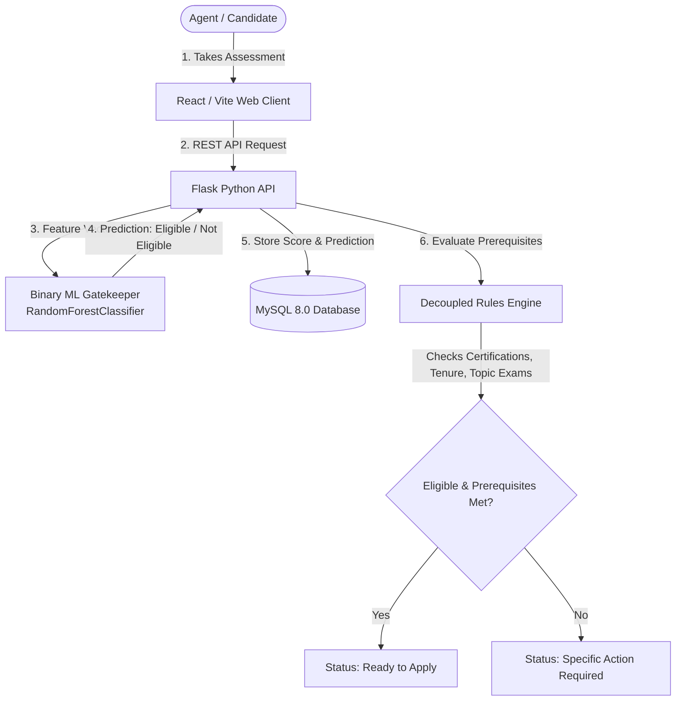

# VerifyMesh

**A Web-Based Workforce Competency Assessment and Task Eligibility Prediction System**  
*Undergraduate Capstone Project — Chapter 5.7 System Implementation & Testing*

---

## 1. System Overview

VerifyMesh is an intelligent workforce competency assessment and task allocation platform. It pairs a **Binary Random Forest Machine Learning Gatekeeper** with a **Decoupled Rules Engine** to verify agent readiness for specialized operational tasks.

The system supports two core actor personas:
- **Agents:** Register, authenticate (local or Google OAuth), undergo competency evaluations, inspect verified credential profiles, and apply for tasks.
- **Administrators:** Review agent credentials and certifications, manage task prerequisites, configure assessment topic frameworks, and assign qualified agents to operational tasks.

---

## 2. Architecture & Design

VerifyMesh decouples **statistical competency classification** from **deterministic task eligibility requirements**:



### Key Architectural Invariant: Decoupled Eligibility
1. **Model Scope:** The Random Forest model predicts strictly two outcomes: **`Eligible`** ($1$) and **`Not Eligible`** ($0$) at a calibrated threshold $\tau = 0.50$.
2. **Business Rule Isolation:** An `Eligible` classification grants baseline competency qualification. However, task assignment strictly enforces independent deterministic requirements (mandatory domain certifications, minimum verified experience months, and topic-specific passing scores) before task applications can be submitted.

---

## 3. Repository Structure

```text
VerifyMesh/
├── .env.example                     # Sanitized environment template (no secrets)
├── .gitignore                       # Clean Python, Node, Vite, IDE, and checkpoint rules
├── README.md                        # Master project documentation (this file)
├── VerifyMesh_System_Test_Report.md # Chapter 5.7 Comprehensive System Test Report
├── requirements.txt                 # Pinned Python dependencies manifest
│
├── data/
│   ├── raw/                         # 2,000-record benchmark dataset (VerifyMesh_Competency_Dataset_V2.csv)
│   └── README.md                    # Data provenance and feature schema documentation
│
├── ml/
│   ├── notebooks/                   # Original Google Colab training notebook (Verify_Mesh.ipynb)
│   ├── train.py                     # Standalone CLI training and cross-validation pipeline
│   ├── evaluate.py                  # Standalone model evaluation and threshold sensitivity audit
│   └── README.md                    # ML reproducibility and feature contract guide
│
├── backend/
│   ├── app.py                       # Flask application entry point
│   ├── config.py                    # Environment-driven configuration and security validation
│   ├── db.py                        # Database connection pool and service queries
│   ├── auth_routes.py               # Authentication (JWT, Google OAuth, Email verification)
│   ├── competency_routes.py         # Assessment, inference, and application endpoints
│   ├── admin_routes.py              # Verification queues, task creation, and administration
│   ├── email_service.py             # SMTP verification and notification service
│   ├── schema.sql                   # Authoritative MySQL database DDL schema
│   ├── migrations/                  # Applied database migrations (002, 003, 004)
│   └── models/                      # Authoritative trained model artifact (binary_eligibility_model.pkl)
│
├── frontend/
│   ├── package.json                 # Node.js dependencies manifest
│   ├── vite.config.js               # Vite frontend build configuration
│   ├── src/
│   │   ├── pages/                   # AgentDashboard, AdminDashboard, ProfilePage, CreateTask, etc.
│   │   ├── components/              # Modals (TaskModal, TakeAssessmentModal, CompetencyDetailsModal)
│   │   ├── context/                 # AuthContext session provider
│   │   └── services/                # Axios API service clients
│
├── src/
│   └── inference.py                 # Production inference engine with 15-feature pipeline
│
├── tests/                           # Complete automated test suite (82 test cases)
│   ├── test_system_suite.py         # 23 end-to-end system test cases (TC001–TC023)
│   ├── test_task_management.py      # 20 task creation, eligibility, and application tests
│   ├── test_exam_workflow.py        # 16 multi-topic examination and attempt integrity tests
│   ├── test_competency_consistency.py# 6 ML inference and threshold regression tests
│   └── test_exam_pass_thresholds.py # 5 pass/fail boundary tests
│
└── docs/
    └── PHASE_1_BINARY_ALIGNMENT_AUDIT.md # Authoritative binary gatekeeper architectural audit
```

---

## 4. Setup & Installation Guide

### Prerequisites
- **Python:** 3.10, 3.11, or 3.12
- **Node.js:** 18.x or 20.x (with `npm`)
- **Database:** MySQL 8.0+

---

### Step 1: Clone Repository & Configure Environment
```bash
git clone https://github.com/Daniel-Obuya/VerifyMesh.git
cd VerifyMesh

# Copy environment template
cp .env.example .env
```
Open `.env` in a text editor and provide your local MySQL credentials:
```ini
SECRET_KEY=generate_a_secure_random_32_byte_string
DB_HOST=localhost
DB_PORT=3306
DB_USER=root
DB_PASSWORD=your_mysql_password
DB_NAME=verifymesh_db
```

---

### Step 2: Set Up Python Virtual Environment
```powershell
# Windows PowerShell
python -m venv .venv
.\.venv\Scripts\Activate.ps1
pip install --upgrade pip
pip install -r requirements.txt
```
```bash
# Linux / macOS
python3 -m venv .venv
source .venv/bin/activate
pip install --upgrade pip
pip install -r requirements.txt
```

---

### Step 3: Initialize Database & Apply Migrations
Log into MySQL and create the database:
```sql
CREATE DATABASE verifymesh_db CHARACTER SET utf8mb4 COLLATE utf8mb4_unicode_ci;
```
Import the authoritative schema and execute migrations:
```powershell
mysql -u root -p verifymesh_db < backend/schema.sql

# Apply migrations
python backend/migrations/migrate_002_assessment_integrity.py
python backend/migrations/migrate_003_assessment_topics_framework.py
python backend/migrations/migrate_004_binary_eligibility_alignment.py
```

---

### Step 4: Install Frontend Dependencies
```powershell
cd frontend
npm install
cd ..
```

---

### Step 5: Start the Development Servers

**Terminal 1 — Backend API:**
```powershell
# In project root with .venv active
python backend/app.py
```
*API runs at `http://127.0.0.1:5000` with health check at `http://127.0.0.1:5000/api/health`.*

**Terminal 2 — Frontend Client:**
```powershell
cd frontend
npm run dev
```
*Web client runs at `http://localhost:5173`.*

---

## 5. Machine Learning Pipeline & Reproducibility

The authoritative Random Forest gatekeeper (`backend/models/binary_eligibility_model.pkl`) evaluates 15 engineered features derived from candidate tenure, certifications, and exam scores.

### Option A: Audit the Pre-Trained Model (No Retraining)
```powershell
python ml/evaluate.py
```
Outputs test holdout accuracy, ROC-AUC score (0.90+), confusion matrix, and threshold sensitivity analysis.

### Option B: Retrain from Scratch
```powershell
# Re-run full training, cross-validation, and artifact serialization
python ml/train.py

# Or test training without overwriting the saved model artifact:
python ml/train.py --no-save
```

### Option C: Interactive Exploration
The research notebook is documented at [`ml/notebooks/Verify_Mesh.ipynb`](file:///c:/Users/DANIEL/Desktop/Verify_Mesh/ml/notebooks/Verify_Mesh.ipynb). See [`ml/README.md`](file:///c:/Users/DANIEL/Desktop/Verify_Mesh/ml/README.md) for full training and feature contract details.

---

## 6. Automated Testing & Verification

The repository contains an automated test suite comprising **82 test cases** covering authentication, assessment attempts, ML inference consistency, and task eligibility:

```powershell
# Execute the full discovery test suite
python -m unittest discover -s tests -p "test_*.py"
```

| Test Suite | File | Tests | Status |
| :--- | :--- | :---: | :---: |
| **System Test Suite (TC001–TC023)** | [`tests/test_system_suite.py`](file:///c:/Users/DANIEL/Desktop/Verify_Mesh/tests/test_system_suite.py) | 23 | **PASS** |
| **Task Management & Applications** | [`tests/test_task_management.py`](file:///c:/Users/DANIEL/Desktop/Verify_Mesh/tests/test_task_management.py) | 20 | **PASS** |
| **Exam Workflow & Topic Banks** | [`tests/test_exam_workflow.py`](file:///c:/Users/DANIEL/Desktop/Verify_Mesh/tests/test_exam_workflow.py) | 16 | **PASS** |
| **Competency & Inference Consistency** | [`tests/test_competency_consistency.py`](file:///c:/Users/DANIEL/Desktop/Verify_Mesh/tests/test_competency_consistency.py) | 6 | **PASS** |
| **Pass/Fail Threshold Boundaries** | [`tests/test_exam_pass_thresholds.py`](file:///c:/Users/DANIEL/Desktop/Verify_Mesh/tests/test_exam_pass_thresholds.py) | 5 | **PASS** |
| **Assessment Integrity & Remediation** | [`tests/test_assessment_integrity.py`](file:///c:/Users/DANIEL/Desktop/Verify_Mesh/tests/test_assessment_integrity.py) | 12 | **PASS** |
| **Total** | | **82** | **100% Passed** |

Detailed system execution evidence, screenshots, and test descriptions are documented in [`VerifyMesh_System_Test_Report.md`](file:///c:/Users/DANIEL/Desktop/Verify_Mesh/VerifyMesh_System_Test_Report.md).

---

## 7. Security & Compliance

- **Zero-Trust Credential Management:** No passwords, Google OAuth client secrets, or SMTP tokens are tracked in version control. The application strictly validates that `SECRET_KEY` is high-entropy and loaded from environment variables at startup.
- **Data Privacy:** All training data in `data/raw/` consists of synthetic benchmark profiles with anonymized identifiers (`AGT00001` - `AGT02000`). No private user data is collected or shared.
- **Audit Logging:** Administrative approvals, task applications, and assessment submissions generate immutable records in the `audit_logs` table.

---

## 8. Authors & Capstone Attribution

- **Author:** Daniel Obuya
- **Institution:** Strathmore University
- **Repository:** [https://github.com/Daniel-Obuya/VerifyMesh](https://github.com/Daniel-Obuya/VerifyMesh)