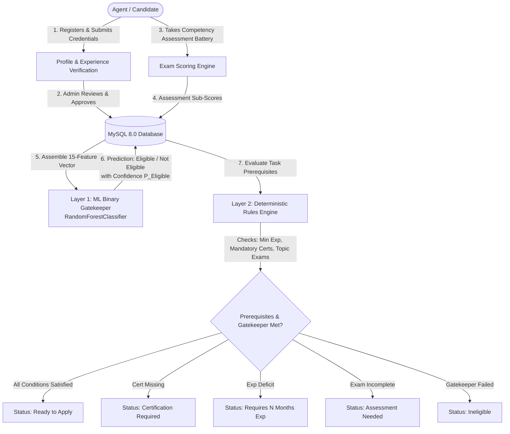

# VerifyMesh: AI-Assisted Workforce Competency & Task Eligibility Engine

**An Intelligent Workforce Qualification Verification and Task Allocation Platform**  
*Undergraduate Computer Science Capstone Project — Chapter 5.7 System Implementation & Testing*  
*Author:* **Daniel Obuya** | *Institution:* **Strathmore University** | *Repository:* [GitHub](https://github.com/Daniel-Obuya/VerifyMesh)

---

## 1. Executive Summary & Problem Statement

In decentralized workforce platforms, crowdsourcing networks, and open gig marketplaces, matching freelance workers to high-stakes operational tasks is frequently compromised by **self-reported credential fraud**, **resume embellishment**, and **manual administrative screening bottlenecks**. 

**VerifyMesh** solves this challenge through a **Dual-Layer Evaluation Architecture**:

1. **Layer 1 — Machine Learning Competency Gatekeeper:** A pre-trained **Binary Random Forest Classifier** (`backend/models/binary_eligibility_model.pkl`) evaluates an engineered 15-dimensional candidate feature vector grounded in administrator-verified domain tenure, verified certifications, and standardized psychometric assessment scores. The model acts as an authoritative, statistical gatekeeper, classifying candidates into **`Eligible`** or **`Not Eligible`** at a calibrated decision threshold ($\tau = 0.50$).
2. **Layer 2 — Decoupled Deterministic Rules Engine:** Cross-references the candidate's verified gatekeeper status against task-specific requirements (mandatory domain certifications, minimum verified experience months, and passing topic-specific exams) to determine task eligibility.

---

## 2. System Architecture & Workflow

VerifyMesh strictly decouples **statistical competency classification** from **deterministic task eligibility enforcement**:



### High-Level End-to-End Workflow

1. **Agent Registration & Profile Setup:** Agents create accounts, authenticate locally or via Google OAuth, and submit work history and credentials.
2. **Credential Verification:** Platform administrators inspect uploaded documentation and approve or reject credentials in the MySQL database.
3. **Assessment Battery:** Agents complete standardized evaluations measuring Communication, Product Knowledge, Sales Skill, and Customer Service.
4. **Feature Assembly & Preprocessing:** When evaluation is triggered, the backend derives tenure from administrator-verified records, computes `certified_leverage`, and calculates statistical aggregate scores (mean, min, max).
5. **Model Inference & Gatekeeper Decision:** The pre-loaded Random Forest model produces an in-memory binary prediction (`Eligible` or `Not Eligible`) along with calibrated probability $P(\text{Eligible})$.
6. **Decoupled Task Matching & Application:** The task catalog dynamically evaluates published task prerequisites. If an agent is ML-verified as `Eligible` AND satisfies all task-specific certifications and experience requirements, their status updates to **`Ready to Apply`**.

---

## 3. Machine Learning Architecture & Reproducibility

VerifyMesh strictly separates **offline model training & research** from **runtime production inference**.

### Model Specifications

| Parameter | Specification |
| :--- | :--- |
| **Model Type** | Scikit-Learn `Pipeline` (`StandardScaler` + `RandomForestClassifier`) |
| **Estimators / Depth** | 150 decision trees, Maximum Depth = 10, Min Samples Split = 5 |
| **Decision Threshold** | $\tau = 0.50$ ($P(\text{Eligible}) \ge 0.50 \implies \text{Eligible}$) |
| **Evaluation Metrics** | **90.75% Holdout Accuracy**, **0.9639 ROC-AUC Score** |
| **Model Artifact** | [`backend/models/binary_eligibility_model.pkl`](file:///c:/Users/DANIEL/Desktop/Verify_Mesh/backend/models/binary_eligibility_model.pkl) (3.45 MB, pre-packaged) |
| **Training Pipeline** | [`ml/train.py`](file:///c:/Users/DANIEL/Desktop/Verify_Mesh/ml/train.py) (CLI script with 5-fold cross-validation) |
| **Evaluation Audit** | [`ml/evaluate.py`](file:///c:/Users/DANIEL/Desktop/Verify_Mesh/ml/evaluate.py) (Holdout metric & threshold sensitivity audit) |
| **Research Notebook** | [`ml/notebooks/Verify_Mesh.ipynb`](file:///c:/Users/DANIEL/Desktop/Verify_Mesh/ml/notebooks/Verify_Mesh.ipynb) (Preserved Google Colab research notebook) |

### Feature Contract (15 Dimensions)

The model expects exactly **15 numerical features** in the precise order specified below:

| Index | Feature Name | Source | Description |
|---:|---|---|---|
| 0 | `previous_experience_months` | MySQL `agent_experience` | Total verified work history across roles. |
| 1 | `sales_experience_months` | MySQL `agent_experience` | Verified tenure in sales roles. |
| 2 | `customer_service_experience_months` | MySQL `agent_experience` | Verified tenure in customer support roles. |
| 3 | `certification_count` | MySQL `agent_certifications` | Total active, verified credentials (0 - 5). |
| 4 | `relevant_certification` | MySQL `agent_certifications` | Binary flag (`1` or `0`) for domain-specific credentials. |
| 5 | `assessment_score` | MySQL `exam_results` | Overall composite core assessment score (0 - 100). |
| 6 | `communication_score` | Assessment sub-score | Standardized communication exam score (0 - 100). |
| 7 | `product_knowledge_score` | Assessment sub-score | Standardized product knowledge exam score (0 - 100). |
| 8 | `sales_skill_score` | Assessment sub-score | Standardized sales negotiation score (0 - 100). |
| 9 | `customer_service_score` | Assessment sub-score | Standardized customer care score (0 - 100). |
| 10 | `certified_leverage` | Engineered Feature | Formula: `certification_count * (1 + relevant_certification)` |
| 11 | `total_experience_months` | Engineered Feature | Formula: `previous + sales + customer_service` |
| 12 | `mean_score` | Engineered Feature | Mean of the 5 assessment battery score fields. |
| 13 | `min_score` | Engineered Feature | Minimum score achieved across the 5 assessment fields. |
| 14 | `max_score` | Engineered Feature | Maximum score achieved across the 5 assessment fields. |

### Dataset Provenance

- **Location:** [`data/raw/VerifyMesh_Competency_Dataset_V2.csv`](file:///c:/Users/DANIEL/Desktop/Verify_Mesh/data/raw/VerifyMesh_Competency_Dataset_V2.csv)
- **Observations:** 2,000 synthetic candidate records (`AGT00001` through `AGT02000`).
- **Binary Mapping:**
  - `[Advanced (400), Competent (700)]` $\to$ **`Eligible`** (1,100 records / 55.0%)
  - `[Basic (600), Needs Improvement (300)]` $\to$ **`Not Eligible`** (900 records / 45.0%)
- **Data Dictionary:** Documented in [`data/README.md`](file:///c:/Users/DANIEL/Desktop/Verify_Mesh/data/README.md).

---

## 4. Repository Structure

```text
VerifyMesh/
├── .env.example                     # Sanitized environment template (no secrets)
├── .gitignore                       # Clean Python, Node, Vite, IDE, and checkpoint rules
├── README.md                        # Master project documentation (this file)
├── VerifyMesh_System_Test_Report.md # Chapter 5.7 Comprehensive System Test Report
├── requirements.txt                 # Pinned Python dependencies manifest
│
├── data/
│   ├── raw/                         # 2,000-record benchmark dataset (VerifyMesh_Competency_Dataset_V2.csv)
│   └── README.md                    # Data provenance and feature schema documentation
│
├── ml/
│   ├── notebooks/                   # Original Google Colab training notebook (Verify_Mesh.ipynb)
│   ├── train.py                     # Standalone CLI training and cross-validation pipeline
│   ├── evaluate.py                  # Standalone model evaluation and threshold sensitivity audit
│   └── README.md                    # ML reproducibility and feature contract guide
│
├── backend/
│   ├── app.py                       # Flask application entry point
│   ├── config.py                    # Environment-driven configuration and security validation
│   ├── db.py                        # Database connection pool and service queries
│   ├── auth_routes.py               # Authentication (JWT, Google OAuth, Email verification)
│   ├── competency_routes.py         # Assessment, inference, and application endpoints
│   ├── admin_routes.py              # Verification queues, task creation, and administration
│   ├── email_service.py             # SMTP verification and notification service
│   ├── schema.sql                   # Authoritative MySQL database DDL schema
│   ├── migrations/                  # Applied database migrations (002, 003, 004)
│   └── models/                      # Authoritative trained model artifact (binary_eligibility_model.pkl)
│
├── frontend/
│   ├── package.json                 # Node.js dependencies manifest
│   ├── vite.config.js               # Vite frontend build configuration
│   ├── src/
│   │   ├── pages/                   # AgentDashboard, AdminDashboard, ProfilePage, CreateTask, etc.
│   │   ├── components/              # Modals (TaskModal, TakeAssessmentModal, CompetencyDetailsModal)
│   │   ├── context/                 # AuthContext session provider
│   │   └── services/                # Axios API service clients
│
├── src/
│   └── inference.py                 # Production inference engine with 15-feature pipeline
│
├── tests/                           # Complete automated test suite (82 test cases)
│   ├── test_system_suite.py         # 23 end-to-end system test cases (TC001–TC023)
│   ├── test_task_management.py      # 20 task creation, eligibility, and application tests
│   ├── test_exam_workflow.py        # 16 multi-topic examination and attempt integrity tests
│   ├── test_competency_consistency.py# 6 ML inference and threshold regression tests
│   └── test_exam_pass_thresholds.py # 5 pass/fail boundary tests
│
└── docs/
    └── PHASE_1_BINARY_ALIGNMENT_AUDIT.md # Authoritative binary gatekeeper architectural audit
```

---

## 5. Setup & Installation Guide

### Prerequisites
- **Python:** 3.10, 3.11, or 3.12
- **Node.js:** 18.x or 20.x (with `npm`)
- **Database:** MySQL Server 8.0 or higher
- **Git**

---

### Step 1: Clone Repository & Configure Environment

```bash
git clone https://github.com/Daniel-Obuya/VerifyMesh.git
cd VerifyMesh

# Copy environment template
cp .env.example .env
```

Configure your local MySQL credentials in `.env`:
```ini
SECRET_KEY=generate_a_secure_random_32_byte_string
DB_HOST=localhost
DB_PORT=3306
DB_USER=root
DB_PASSWORD=your_mysql_password
DB_NAME=verifymesh_db
```

---

### Step 2: Set Up Python Virtual Environment

**Windows PowerShell:**
```powershell
python -m venv .venv
.\.venv\Scripts\Activate.ps1
pip install --upgrade pip
pip install -r requirements.txt
```

**Linux / macOS:**
```bash
python3 -m venv .venv
source .venv/bin/activate
pip install --upgrade pip
pip install -r requirements.txt
```

---

### Step 3: MySQL Database Initialization & Migrations

Ensure that MySQL is running locally on port `3306`. Create the database and import the authoritative schema:

```sql
CREATE DATABASE verifymesh_db CHARACTER SET utf8mb4 COLLATE utf8mb4_unicode_ci;
```

Import schema and execute migrations:
```powershell
mysql -u root -p verifymesh_db < backend/schema.sql

# Apply database migrations
python backend/migrations/migrate_002_assessment_integrity.py
python backend/migrations/migrate_003_assessment_topics_framework.py
python backend/migrations/migrate_004_binary_eligibility_alignment.py
```

---

### Step 4: Install Frontend Dependencies

```powershell
cd frontend
npm install
cd ..
```

---

### Step 5: Start the Development Servers

**Terminal 1 — Flask API Backend:**
```powershell
# In project root with .venv activated
python backend/app.py
```
*API runs at `http://127.0.0.1:5000` with health check at `http://127.0.0.1:5000/api/health`.*

**Terminal 2 — React / Vite Frontend:**
```powershell
cd frontend
npm run dev
```
*Web client runs at `http://localhost:5173`.*

---

## 6. Seeded Development Accounts

The database schema and seeds provide default testing accounts:

| Role | Email | Password | Description |
|:--- |:--- |:--- |:--- |
| **Agent** | `alex.morgan@university.edu` | `password123` | Pre-configured test agent with sample work history and credentials. |
| **Administrator** | `admin@verifymesh.io` | `password123` | Platform administrator with verification and task creation privileges. |

> [!WARNING]
> These credentials are for local development and academic demonstration only. Never deploy default credentials in a production environment.

---

## 7. API Endpoints Overview

| Blueprint | Method | Endpoint | Access | Description |
|:--- |:---: |:--- |:---: |:--- |
| **System** | `GET` | `/api/health` | Public | System status, database health, and ML model loaded flag. |
| **Auth** | `POST` | `/api/auth/register` | Public | Registers a new agent profile and initiates email verification. |
| **Auth** | `POST` | `/api/auth/verify-email` | Public | Validates OTP verification code and activates user account. |
| **Auth** | `POST` | `/api/auth/login` | Public | Authenticates credentials and returns signed session token. |
| **Competency** | `GET` | `/api/competency/profile` | Agent | Retrieves agent profile, credentials, and readiness metrics. |
| **Competency** | `PUT` | `/api/competency/profile` | Agent | Updates personal bio and contact information. |
| **Competency** | `POST` | `/api/competency/experiences` | Agent | Submits employment record for administrative verification. |
| **Competency** | `POST` | `/api/competency/certifications` | Agent | Submits certification document for review. |
| **Competency** | `POST` | `/api/competency/evaluate` | Agent | Executes Layer 1 ML inference and persists result. |
| **Competency** | `GET` | `/api/competency/tasks` | Agent | Retrieves published tasks with real-time eligibility states. |
| **Competency** | `POST` | `/api/competency/tasks/<id>/apply`| Agent | Server-side validated application submission. |
| **Competency** | `GET` | `/api/competency/model-info` | Public | Returns model architecture, feature order, and classes. |
| **Admin** | `GET` | `/api/admin/overview` | Admin | Platform-wide operational metrics and recent activities. |
| **Admin** | `GET` | `/api/admin/agents` | Admin | Candidate roster with competency status filter. |
| **Admin** | `GET` | `/api/admin/tasks` | Admin | Full task catalog with configured prerequisites. |
| **Admin** | `POST` | `/api/admin/tasks` | Admin | Creates a task with experience and certification rules. |
| **Admin** | `GET` | `/api/admin/verifications` | Admin | Queue of pending experience and certification submissions. |
| **Admin** | `PUT` | `/api/admin/verifications/certifications/<id>` | Admin | Approves or rejects submitted certification with reason. |

---

## 8. Automated Testing & Verification Suite

VerifyMesh contains **82 automated tests** executing against the live database and ML model:

```powershell
python -m unittest discover -s tests -p "test_*.py"
```

```text
Ran 82 tests in 43.495s

OK
```

| Test Suite | File | Tests | Coverage Scope | Status |
| :--- | :--- | :---: | :--- | :---: |
| **System Test Suite** | [`tests/test_system_suite.py`](file:///c:/Users/DANIEL/Desktop/Verify_Mesh/tests/test_system_suite.py) | 23 | End-to-end integration (TC001–TC023) | **100% PASS** |
| **Task Management** | [`tests/test_task_management.py`](file:///c:/Users/DANIEL/Desktop/Verify_Mesh/tests/test_task_management.py) | 20 | Task creation, requirements, applications | **100% PASS** |
| **Exam Workflow** | [`tests/test_exam_workflow.py`](file:///c:/Users/DANIEL/Desktop/Verify_Mesh/tests/test_exam_workflow.py) | 16 | Multi-topic battery, timers, scoring | **100% PASS** |
| **Assessment Integrity** | [`tests/test_assessment_integrity.py`](file:///c:/Users/DANIEL/Desktop/Verify_Mesh/tests/test_assessment_integrity.py) | 12 | Non-destructive reset, cooldowns, logs | **100% PASS** |
| **Competency Consistency**| [`tests/test_competency_consistency.py`](file:///c:/Users/DANIEL/Desktop/Verify_Mesh/tests/test_competency_consistency.py) | 6 | ML inference & boundary regression | **100% PASS** |
| **Threshold Boundaries** | [`tests/test_exam_pass_thresholds.py`](file:///c:/Users/DANIEL/Desktop/Verify_Mesh/tests/test_exam_pass_thresholds.py) | 5 | Deterministic pass/fail scoring logic | **100% PASS** |
| **Total** | | **82** | **Full System Coverage** | **100% Passed** |

Comprehensive test execution records, screenshots, and validation matrices are detailed in [`VerifyMesh_System_Test_Report.md`](file:///c:/Users/DANIEL/Desktop/Verify_Mesh/VerifyMesh_System_Test_Report.md).

---

## 9. Technology Stack

- **Frontend Client:** React 18, Vite, React Router 6, Tailwind CSS, Lucide Icons, Axios
- **Backend API:** Python 3.12, Flask, PyMySQL (Connection Pooling), Werkzeug Security, itsdangerous
- **Database:** MySQL 8.0 (InnoDB, ACID compliant, UTF-8 Unicode)
- **Machine Learning:** Scikit-Learn 1.6+, Joblib, Pandas, NumPy, Matplotlib, Seaborn
- **Authentication & Security:** Signed bearer tokens, Google OAuth 2.0, Zero-Trust credential isolation, audit logging
- **Quality Assurance:** Python `unittest` framework (82 automated tests)
- **Model Training:** Google Colab & Python CLI (`ml/train.py`)

---

## 10. License & Academic Disclaimer

VerifyMesh was developed as an undergraduate Computer Science capstone project at **Strathmore University**. It is intended for academic, research, and technical demonstration purposes.