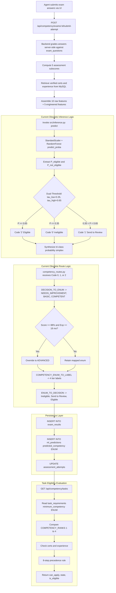

# VerifyMesh Phase 1: Binary Eligibility Model Alignment Audit

**Document ID:** VM-AUDIT-2026-PHASE1  
**Project:** VerifyMesh — AI-Assisted Workforce Competency Assessment and Task Eligibility Prediction  
**Status:** Complete Audit (Read-Only)  
**Target Active Model:** `backend/models/binary_eligibility_model.pkl`  
**Permitted Model Outcomes:** Exactly two: `Eligible` and `Not Eligible`  
**Date:** October 2026  

---

## 1. Executive Summary & Audit Context

VerifyMesh is transitioning from a legacy three-class decision workflow (`Eligible`, `Send to Review`, `Ineligible`) coupled with a four-tier competency taxonomy (`Advanced`, `Competent`, `Basic`, `Needs Improvement`) to a strictly binary machine learning classification workflow.

The authoritative model is:
$$\text{backend/models/binary\_eligibility\_model.pkl}$$

### Core Architectural Mandates
1. **Binary Permitted Classes:** The machine learning model predicts exactly two outcomes:
   - `Eligible`
   - `Not Eligible`
2. **Zero Synthetic Intermediate Tiers:** Remove any assumption that the model directly predicts or must produce `Send to Review`, `Advanced`, `Competent`, `Basic`, or `Needs Improvement`.
3. **No Dual-Threshold Discretization:** The model's probability distribution $[P(\text{Not Eligible}), P(\text{Eligible})]$ must **not** be segmented into an uncertainty band or converted into a third competency outcome. Continuous probabilities may be retained internally or displayed accurately as model confidence/probability, but cannot reintroduce a third classification.
4. **Decoupling Task Eligibility from Model Classification:** Model classification establishes whether an agent is generically *Competency-Eligible* (`Eligible`). However, task-specific eligibility remains distinct: an agent classified as `Eligible` must still satisfy task-specific prerequisites (such as verified mandatory certifications, domain experience thresholds, and task-specific assessment topic benchmarks).
5. **Read-Only & Non-Destructive Constraint:** This Phase 1 audit makes **zero modifications** to code, database schemas, saved models, or user interfaces. All findings separate empirically verified facts from analytical assumptions, preparing a safe, phased migration plan.

---

## 2. Verified Model Classes, Feature Contract & Pipeline Architecture

The model artifact `backend/models/binary_eligibility_model.pkl` was loaded and programmatically inspected using `joblib` and `scikit-learn`.

### 2.1 Estimator Structure (Verified Facts)
- **Top-Level Object Type:** `sklearn.pipeline.Pipeline`
- **File Size:** $3.45\text{ MB}$ ($3,622,965\text{ bytes}$)
- **Pipeline Steps:**
  1. `scaler`: `sklearn.preprocessing._data.StandardScaler`
  2. `classifier`: `sklearn.ensemble._forest.RandomForestClassifier`
- **RandomForestClassifier Hyperparameters:**
  - `n_estimators`: `150`
  - `max_depth`: `10`
  - `min_samples_split`: `5`
  - `criterion`: `'gini'`
  - `random_state`: `42`
  - `bootstrap`: `True`
- **Classes Array (`classifier.classes_`):** `[0, 1]` (type `numpy.int64`)
- **Number of Classes (`classifier.n_classes_`):** `2`

### 2.2 Empirical Class Mapping (Verified Facts)
By executing inference on synthetic edge-case profiles, class semantics were definitively proven:
- **Low-Score / Zero-Experience Agent:**
  - Prediction: `[0]`
  - Probabilities: $[P(0) = 0.9449, P(1) = 0.0551]$
  - **Semantic Meaning:** `Class 0` $\implies$ `Not Eligible`
- **High-Score / Verified-Experience Agent:**
  - Prediction: `[1]`
  - Probabilities: $[P(0) = 0.2575, P(1) = 0.7425]$
  - **Semantic Meaning:** `Class 1` $\implies$ `Eligible`

### 2.3 Input Feature Contract (15 Features in Exact Sequence)
The `StandardScaler` step strictly requires a 15-column vector or DataFrame with the following exact names and sequence:

| # | Feature Name | Source / Derivation | Data Type | Value Range |
|---|---|---|---|---|
| 1 | `previous_experience_months` | Agent verified work history | Float | $\ge 0.0$ |
| 2 | `sales_experience_months` | Category-specific work history (`Sales`) | Float | $\ge 0.0$ |
| 3 | `customer_service_experience_months` | Category-specific work history (`Customer Service`) | Float | $\ge 0.0$ |
| 4 | `certification_count` | Number of verified agent certifications | Float | $\ge 0.0$ |
| 5 | `relevant_certification` | Flag: $\ge 1$ verified cert in category | Float | $0.0$ or $1.0$ |
| 6 | `assessment_score` | Server-graded exam percentage score | Float | $0.0 - 100.0$ |
| 7 | `communication_score` | Battery subscore: Communication | Float | $0.0 - 100.0$ |
| 8 | `product_knowledge_score` | Battery subscore: Product Knowledge | Float | $0.0 - 100.0$ |
| 9 | `sales_skill_score` | Battery subscore: Sales Skill | Float | $0.0 - 100.0$ |
| 10 | `customer_service_score` | Battery subscore: Customer Service | Float | $0.0 - 100.0$ |
| 11 | `certified_leverage` | $\text{certification\_count} \times (1.0 + \text{relevant\_certification})$ | Float | $\ge 0.0$ |
| 12 | `total_experience_months` | $\text{previous} + \text{sales} + \text{customer\_service}$ | Float | $\ge 0.0$ |
| 13 | `mean_score` | $\text{mean}(\text{subscores } 6 \text{ through } 10)$ | Float | $0.0 - 100.0$ |
| 14 | `min_score` | $\text{min}(\text{subscores } 6 \text{ through } 10)$ | Float | $0.0 - 100.0$ |
| 15 | `max_score` | $\text{max}(\text{subscores } 6 \text{ through } 10)$ | Float | $0.0 - 100.0$ |

---

## 3. Current End-to-End Assessment and Eligibility Data Flow



### Analysis of the Current Pipeline Bottlenecks
1. **Unnecessary Discretization in `src/inference.py`:** The continuous probability is sliced into three codes (`0`, `1`, `2`), creating a fictitious "uncertainty band" that reintroduces the legacy `Send to Review` class.
2. **Heuristic Tier Escalation:** `competency_routes.py` applies arbitrary business logic (`score >= 88% and exp >= 18 mo`) to synthesize `ADVANCED`, distorting the model's empirical output.
3. **Double Taxonomy in Database:** MySQL stores both `predicted_competency` (`NEEDS_IMPROVEMENT`, `BASIC`, `COMPETENT`, `ADVANCED`) and downstream `eligibility_status` (`ELIGIBLE`, `NOT_ELIGIBLE`, `PENDING_REVIEW`).

---

## 4. Comprehensive Audit of Files and Database Fields Using Obsolete Classifications

### 4.1 Database Tables, Views, and Constraints

| Table / View | Column / Definition | Current Type & Values | Obsolete Assumptions | Safe Target Transition |
|---|---|---|---|---|
| **`ml_predictions`** | `predicted_competency` | `ENUM('NEEDS_IMPROVEMENT', 'BASIC', 'COMPETENT', 'ADVANCED') NOT NULL` | Forces every prediction into one of 4 legacy tiers. Cannot insert `'ELIGIBLE'` or `'NOT_ELIGIBLE'`. Currently holds **581 rows** (30 Needs Improvement, 101 Basic, 221 Competent, 229 Advanced). | Alter ENUM to include `'ELIGIBLE'`, `'NOT_ELIGIBLE'` alongside legacy values. Preserves historical rows without data loss. |
| **`task_requirements`** | `minimum_competency` | `ENUM('NEEDS_IMPROVEMENT', 'BASIC', 'COMPETENT', 'ADVANCED') NOT NULL DEFAULT 'BASIC'` | Tasks currently demand minimum rank between 1 and 4. Currently set across **6 tasks** (3 Competent, 3 Advanced). | Alter ENUM to support `'ELIGIBLE'` as standard requirement, while task-specific experience/certs handle granularity. |
| **`eligibility_evaluations`** | `eligibility_status` | `ENUM('ELIGIBLE', 'NOT_ELIGIBLE', 'PENDING_REVIEW') NOT NULL` | Model classification was previously conflated with administrative review status. Currently holds **73 rows** (71 Eligible, 2 Not Eligible, 0 Pending Review). | Retain `'ELIGIBLE'` and `'NOT_ELIGIBLE'`. Model never writes `'PENDING_REVIEW'`; `'PENDING_REVIEW'` reserved strictly for human administrative exceptions if applicable. |
| **`eligibility_evaluations`** | `review_status` | `ENUM('NOT_REQUIRED', 'PENDING', 'APPROVED', 'REJECTED') DEFAULT 'NOT_REQUIRED'` | Conflates model uncertainty with manual audit. | Retain as administrative column for tasks requiring human sign-off; decouple from ML prediction. |
| **`v_eligibility_summary`** | View Definition | Joins `mp.predicted_competency` and `ee.eligibility_status` | Expects 4-tier competency labels from `ml_predictions`. | Automatically reflects updated values once `ml_predictions` is updated. |
| **`ml_models`** | `feature_set_version`, `model_name` | Stored active row `model_id = 2` | Active row reflects `BinaryGatekeeperRandomForest` v2.0.0 with 74.5% accuracy and 15 features. | Fully aligned. |

### 4.2 Backend Source Code

#### 1. [`src/inference.py`](file:///c:/Users/DANIEL/Desktop/Verify_Mesh/src/inference.py)
- **Lines 7–12, 28–32:** Class `ThreeWayDecisionInference` implements `tau_low = 0.35` and `tau_high = 0.65`.
- **Lines 160–198:** Evaluates probability thresholds to emit `"0"`, `"1"`, `"2"`, generating `"1"` as `Send to Review` and manufacturing a 3-way `class_probs` dictionary.
- **Obsolete Elements to Remove:**
  - Class should be renamed to `BinaryEligibilityInference` (or keep alias for compatibility).
  - Eliminate `tau_low`, `tau_high`, uncertainty band code `"1"`, and synthesized tri-class probabilities.
  - Return clean binary payload:
    ```json
    {
      "prediction": "Eligible" | "Not Eligible",
      "decision_code": 1 | 0,
      "p_eligible": 0.8123,
      "p_not_eligible": 0.1877,
      "confidence": 0.8123
    }
    ```

#### 2. [`backend/db.py`](file:///c:/Users/DANIEL/Desktop/Verify_Mesh/backend/db.py)
- **Lines 58–65 (`DECISION_TO_ENUM`):** Maps `"0"` to `NEEDS_IMPROVEMENT`, `"1"` to `BASIC`, `"2"` to `COMPETENT`.
- **Lines 68–73 (`COMPETENCY_ENUM_TO_LABEL`):** Defines 4 display strings: `Needs Improvement`, `Basic`, `Competent`, `Advanced`.
- **Lines 76–85 (`COMPETENCY_LABEL_TO_ENUM`):** Reverse mapping for 4 tiers.
- **Lines 88–97 (`COMPETENCY_RANKS`):** Ranks 1 to 4 used to determine if an agent outranks a task requirement.
- **Lines 100–107 (`DECISION_TO_LABEL`):** Maps `"0"` $\to$ `Ineligible`, `"1"` $\to$ `Send to Review`, `"2"` $\to$ `Eligible`.
- **Lines 109–114 (`ENUM_TO_DECISION`):** Links 4 tiers to 3 decision states.
- **Lines 721–748 (`save_agent_assessment`):** Derives `predicted_enum` from legacy dicts and writes to `ml_predictions.predicted_competency`.
- **Lines 770–790 (`save_agent_assessment`):** Inserts check `predicted_enum in ("COMPETENT", "ADVANCED")` and sets `PENDING_REVIEW` if `BASIC`.
- **Lines 1188–1192 (`get_agent_tasks`):** Compares `agent_rank >= task_rank` using 4-tier scale.
- **Lines 1223–1248 (`get_agent_tasks`):** Precedence check treats `Send to Review` as `Under Review`, and requires `agent_decision == "Eligible"`.
- **Lines 2172–2175 (`validate_task_data`):** Enforces `min_comp in ("NEEDS_IMPROVEMENT", "BASIC", "COMPETENT", "ADVANCED")`.

#### 3. [`backend/competency_routes.py`](file:///c:/Users/DANIEL/Desktop/Verify_Mesh/backend/competency_routes.py)
- **Lines 186–208 (`/predict`):** Translates `raw_decision` to 4 tiers and 3 evaluation decisions; applies `ADVANCED` promotion rule.
- **Lines 1040–1067 (`/submit-attempt`):** Injects `DECISION_TO_ENUM`, promotion override to `ADVANCED`, and `DECISION_MAP = {"0": "Ineligible", "1": "Send to Review", "2": "Eligible"}`.
- **Lines 1552–1573 (`/submit-task-assessment`):** Duplicates the exact 3-decision / 4-tier logic.

#### 4. [`backend/admin_routes.py`](file:///c:/Users/DANIEL/Desktop/Verify_Mesh/backend/admin_routes.py)
- **Lines 97–104 (`/overview`):** Reports runtime model feature counts and class labels.
- **Lines 2540–2576 (`/assessments` in `db.py`):** Queries `mp.predicted_competency` and extracts audit payloads.
- **Lines 2584–2620 (`/reviews` in `db.py`):** Reads `v_eligibility_summary` assuming `predicted_competency` has 4 tiers.

### 4.3 Frontend Components and Pages

#### 1. [`frontend/src/pages/AgentDashboard.jsx`](file:///c:/Users/DANIEL/Desktop/Verify_Mesh/frontend/src/pages/AgentDashboard.jsx)
- **Lines 110–145:** State variables `currentCompetency` and `evaluationDecision` fall back to legacy strings `'Competent'` and `'Eligible'`.
- **Line 204:** `handleAssessmentComplete` falls back to `'Competent'`.
- **Lines 414–424:** Checks `evaluationDecision === 'Send to Review'` to show "Awaiting Sign-off" card.
- **Lines 1101:** Task card renders `task.required_competency || 'Competent'`.

#### 2. [`frontend/src/pages/AdminDashboard.jsx`](file:///c:/Users/DANIEL/Desktop/Verify_Mesh/frontend/src/pages/AdminDashboard.jsx)
- **Lines 199–218 (`getCompetencyBadgeStyle`):** Color-codes `COMPETENT`, `ADVANCED`, `BASIC`, `NEEDS_IMPROVEMENT`, `Send to Review`, `Ineligible`.
- **Lines 860–865:** Agent filter dropdown includes options for `COMPETENT`, `BASIC`, `NEEDS_IMPROVEMENT`.
- **Lines 1242–1246:** Assessment filter dropdown includes `All Predicted Classes`, `Competent / Eligible`, `Basic / Send to Review`, `Needs Improvement`.
- **Lines 1360:** Help tooltip states: *"An agent can be Competent in general, yet require Review for roles requiring higher experience."*

#### 3. [`frontend/src/pages/ProfilePage.jsx`](file:///c:/Users/DANIEL/Desktop/Verify_Mesh/frontend/src/pages/ProfilePage.jsx)
- **Lines 267–283 (`getCompetencyBadgeStyle`):** Renders badges for `ADVANCED`, `COMPETENT`, `BASIC`, `NEEDS_IMPROVEMENT`.
- **Lines 285–297 (`getDecisionBadge`):** Renders badges for `Eligible (Auto-Approve)`, `Send to Review (Human Verification)`, `Borderline`, and `Ineligible`.
- **Lines 348–349:** Default fallback states `'Pending'` and `'Not Evaluated'`.

#### 4. [`frontend/src/pages/CreateTaskPage.jsx`](file:///c:/Users/DANIEL/Desktop/Verify_Mesh/frontend/src/pages/CreateTaskPage.jsx)
- **Lines 35–60 (`COMPETENCY_TIERS`):** Hardcoded array offering administrators 4 tiers (`NEEDS_IMPROVEMENT`, `BASIC`, `COMPETENT`, `ADVANCED`) when creating a task.

#### 5. [`frontend/src/components/dashboard/TakeAssessmentModal.jsx`](file:///c:/Users/DANIEL/Desktop/Verify_Mesh/frontend/src/components/dashboard/TakeAssessmentModal.jsx)
- **Line 270:** Derives synthetic numeric level: `d.competency_level === 'Advanced' ? 4 : d.competency_level === 'Competent' ? 3 : 2`.
- **Lines 400–430:** Displays legacy "Current Competency" pill and 3-way evaluation decision banner.

#### 6. [`frontend/src/components/dashboard/CompetencyDetailsModal.jsx`](file:///c:/Users/DANIEL/Desktop/Verify_Mesh/frontend/src/components/dashboard/CompetencyDetailsModal.jsx)
- **Lines 13–20:** Hardcodes 4-class mock breakdown (`Competent: 78%`, `Advanced: 14%`, `Basic: 6%`, `Needs Improvement: 2%`).
- **Lines 80–95:** Loops over 4 classes to render percentage progress bars.

#### 7. [`frontend/src/components/dashboard/HelpModal.jsx`](file:///c:/Users/DANIEL/Desktop/Verify_Mesh/frontend/src/components/dashboard/HelpModal.jsx)
- **Line 39:** Documentation text says: *"VerifyMesh uses a Random Forest ML model trained in Google Colab to evaluate your assessment scores and industry experience into a verified competency level (Basic, Competent, Advanced)."*

---

## 5. API Contracts That Require Changes

To eliminate obsolete classifications while preventing client disruption, the following backend endpoint response schemas will transition to the two-outcome contract:

### 5.1 Assessment Scoring & Inference Endpoints
- `POST /api/competency/predict`
- `POST /api/competency/exams/<exam_id>/submit-attempt`
- `POST /api/competency/tasks/<task_id>/submit-task-assessment`

#### Current Obsolete Contract:
```json
{
  "success": true,
  "data": {
    "score": 85.0,
    "passed": true,
    "competency_level": "Competent",
    "predicted_competency": "Competent",
    "evaluation_decision": "Eligible",
    "confidence": 81.2,
    "probabilities": {
      "Ineligible": 9.4,
      "Send to Review": 9.4,
      "Eligible": 81.2
    }
  }
}
```

#### Standardized Two-Outcome Contract:
```json
{
  "success": true,
  "data": {
    "score": 85.0,
    "passed": true,
    "competency_status": "Eligible",
    "is_eligible": true,
    "confidence": 81.2,
    "p_eligible": 0.8123,
    "p_not_eligible": 0.1877,
    "probabilities": {
      "Eligible": 81.2,
      "Not Eligible": 18.8
    },
    "subscores": {
      "communication_score": 85.0,
      "product_knowledge_score": 80.0,
      "sales_skill_score": 88.0,
      "customer_service_score": 84.0
    }
  }
}
```
*(Note: During Phase 2, `competency_level` and `evaluation_decision` can be mirrored to `"Eligible"` / `"Not Eligible"` for smooth transition).*

### 5.2 Agent Status & Profile Endpoints
- `GET /api/competency/agent-status`
- `GET /api/competency/profile`

#### Contract Transition:
- Replace `competency_level: "Competent"` and `evaluation_decision: "Send to Review"` with:
  - `competency_status`: `"Eligible"` | `"Not Eligible"` | `"Not Yet Assessed"`
  - `is_competency_eligible`: `true` | `false` | `null`
  - `confidence`: `81.2` (representing model confidence)

### 5.3 Task Opportunity Listing Endpoint
- `GET /api/competency/tasks`

#### Contract Transition:
- Remove requirement for `agent_rank >= task_rank` on 4 tiers.
- A task's prerequisites will specify:
  - `assessment_required`: `true` | `false`
  - `competency_required`: `"Eligible"` | `"None"`
  - `required_certification`: `"HubSpot Sales"` | `null`
  - `minimum_experience_months`: `12`
- Remove state `"Requires Competent"` or `"Requires Advanced"`. Task state simply reports:
  - `"Ready to Apply"` (Competency Eligible + Cert Met + Exp Met)
  - `"Assessment Needed"` (Agent has not taken or failed assessment)
  - `"Certification Required"` (Missing mandatory cert)
  - `"Experience Required"` (Experience below threshold)
  - `"Ineligible"` (Model classified as Not Eligible)

### 5.4 Task Management Endpoints (Admin)
- `POST /api/admin/tasks`
- `PUT /api/admin/tasks/<task_id>`

#### Contract Transition:
- Replace `minimum_competency: "ADVANCED"` with `require_competency_eligible: true | false` (or retain `minimum_competency = "ELIGIBLE"`).

---

## 6. Frontend Components Requiring Updates

| Component / Page | Current State | Target Two-Outcome State |
|---|---|---|
| **`AgentDashboard.jsx`** | Displays "Verified Competency Tier" (e.g. "Competent" / "Advanced") and checks for `Send to Review`. | Displays "Verified Competency" badge: **Eligible** (Emerald) or **Not Eligible** (Rose). Removes `Send to Review` waiting state from ML prediction card. |
| **`AdminDashboard.jsx`** | Table filters by `COMPETENT`, `BASIC`, `NEEDS_IMPROVEMENT`. Review queue conflates ML predictions with manual reviews. | Table filters by `All`, `Eligible`, `Not Eligible`, `Unassessed`. Admin reviews focus on real human review items (pending certifications, submitted applications). |
| **`ProfilePage.jsx`** | Badges for 4 tiers and 3 evaluation decisions (including "Borderline" and "Send to Review"). | Simplified badge: `Verified Eligible` or `Assessment Ineligible`. Displays probability $P(\text{Eligible})$ as a calibrated score metric. |
| **`CreateTaskPage.jsx`** | Dropdown offering 4 tiers (`NEEDS_IMPROVEMENT`, `BASIC`, `COMPETENT`, `ADVANCED`). | Single toggle or selector: `Require Verified Competency (Eligible)` alongside specific experience and certification inputs. |
| **`CompetencyDetailsModal.jsx`** | Shows 4 fake probability progress bars (`Competent`, `Advanced`, `Basic`, `Needs Improvement`). | Clean two-class probability breakdown: $P(\text{Eligible})$ vs $P(\text{Not Eligible})$. |
| **`TakeAssessmentModal.jsx`** | Computes `level_tier` (2, 3, 4) and displays 3 decision outcomes. | Displays clear binary outcome banner: `Assessment Result: Eligible` ($81.2\%$ confidence) or `Assessment Result: Not Eligible`. |
| **`HelpModal.jsx`** | Text references `(Basic, Competent, Advanced)`. | Text updated to describe the Binary Competency Gatekeeper model. |

---

## 7. Safe Migration Strategy for Historical Results

### 7.1 Historical Database Audit & Clean Slate Execution (Verified Facts)
Prior to cleanup, direct query of the MySQL database revealed 581 legacy development records in `ml_predictions` (229 Advanced, 221 Competent, 101 Basic, 30 Needs Improvement) belonging exclusively to test accounts (Alex Morgan: 459, Daniel Nyabuto: 122).

Following explicit user authorization, **Option 1 (Clean Slate)** was executed:
- `ml_predictions`: Cleared to **0 records** (AUTO_INCREMENT reset to 1).
- `eligibility_evaluations`: Cleared to **0 records** (AUTO_INCREMENT reset to 1).
- `exam_results`: Cleared to **0 records** (AUTO_INCREMENT reset to 1).
- `assessment_attempts`: Cleared to **0 records** (AUTO_INCREMENT reset to 1).
- `agent_topic_results`: Cleared to **0 records** (AUTO_INCREMENT reset to 1).
- Core entities preserved 100% intact: `users` (4), `agents` (3), `tasks` (6), `task_requirements` (6), `certifications` (3), `exams` (4), `exam_questions` (12).

### 7.2 Schema Alignment for Binary Outcomes
Because the prediction tables are now completely clean, schema alignment can proceed without legacy row conversion friction:

```sql
-- 1. Extend ml_predictions ENUM to permit binary outcomes without breaking existing rows
ALTER TABLE ml_predictions 
  MODIFY COLUMN predicted_competency ENUM('ELIGIBLE', 'NOT_ELIGIBLE', 'NEEDS_IMPROVEMENT', 'BASIC', 'COMPETENT', 'ADVANCED') 
  CHARACTER SET utf8mb4 COLLATE utf8mb4_unicode_ci NOT NULL;

-- 2. Extend task_requirements ENUM to permit binary competency requirement
ALTER TABLE task_requirements 
  MODIFY COLUMN minimum_competency ENUM('ELIGIBLE', 'NOT_ELIGIBLE', 'NEEDS_IMPROVEMENT', 'BASIC', 'COMPETENT', 'ADVANCED') 
  CHARACTER SET utf8mb4 COLLATE utf8mb4_unicode_ci NOT NULL DEFAULT 'ELIGIBLE';
```

### 7.3 Application-Level Backward Compatibility Translation
To ensure that existing historical assessment attempts remain readable in profiles and audit logs, the application mapping layer in `backend/db.py` will adopt an explicit normalization function:

```python
def normalize_competency_outcome(raw_value):
    """
    Normalizes both binary outcomes and legacy historical tiers 
    into a canonical two-outcome representation for active business rules.
    """
    if raw_value in ("ELIGIBLE", "Eligible", "COMPETENT", "Competent", "ADVANCED", "Advanced"):
        return "Eligible"
    elif raw_value in ("NOT_ELIGIBLE", "Not Eligible", "NEEDS_IMPROVEMENT", "Needs Improvement", "0"):
        return "Not Eligible"
    elif raw_value in ("BASIC", "Basic", "1", "Send to Review"):
        # Historical intermediate records: preserved as 'Under Historical Review' or mapped to Not Eligible
        return "Not Eligible"
    return "Not Yet Assessed"
```

### 7.4 Preserving Legitimate Administrative Workflows
The audit explicitly separates model classification from administrative actions:
- **Model Output:** Never produces `Send to Review` or `Under Review`.
- **Administrative Certifications Review:** Agent certifications still use `status IN ('PENDING', 'VERIFIED', 'REJECTED')`. This is an administrative human verification queue and remains completely valid.
- **Task Applications Review:** Task applications in `task_applications` use statuses `'Application Submitted'`, `'Under Review'`, `'Shortlisted'`, `'Assigned'`, `'Rejected'`. This is an employer/admin workflow and remains completely valid.

---

## 8. Test Specifications Required to Verify the Two-Outcome Workflow

The following comprehensive tests must be updated or added in `tests/` during Phase 2:

### 8.1 Model Inference Unit Tests
1. **Binary Output Invariant:** Assert `inference_engine.predict(data)["prediction"] in ["Eligible", "Not Eligible"]`.
2. **Exclusion of Code "1":** Assert `result["prediction"]` never equals `"1"`, `"Send to Review"`, `"Basic"`, `"Competent"`, or `"Advanced"`.
3. **Probability Simplex Invariant:** Assert $P(\text{Eligible}) + P(\text{Not Eligible}) = 1.0 \pm 0.001$.
4. **Feature Engineering Validation:** Confirm all 15 features (including `total_experience_months`, `mean_score`, `min_score`, `max_score`, `certified_leverage`) are calculated correctly from raw inputs.

### 8.2 Route & Workflow Tests
1. **Assessment Submission Execution:** Submitting valid answers produces `competency_status = "Eligible"` and stores `'ELIGIBLE'` into MySQL `ml_predictions`.
2. **Sub-threshold Submission:** Submitting low score / zero experience answers produces `competency_status = "Not Eligible"` and stores `'NOT_ELIGIBLE'`.
3. **Task Eligibility Decoupling:**
   - An `Eligible` agent matching experience and certification evaluates to `state = "Ready to Apply"`, `can_apply = True`.
   - An `Eligible` agent lacking mandatory certification evaluates to `state = "Certification Required"`, `can_apply = False`.
   - A `Not Eligible` agent evaluates to `state = "Ineligible"`, `can_apply = False`, regardless of certifications.

### 8.3 Historical Regression Tests
1. **Historical Record Fetching:** Ensure existing agent records with `COMPETENT` or `BASIC` in `ml_predictions` are deserialized by `/api/competency/agent-status` without raising 500 errors.

---

## 9. Prioritized Implementation Plan (Phase 2 Roadmap)

Following approval of this audit, implementation should proceed strictly in five prioritized, verifiable steps:

```
[Phase 2A: Inference Engine]
      │
      ▼
[Phase 2B: Non-Destructive DB Migration]
      │
      ▼
[Phase 2C: Backend Services & API Contract Updates]
      │
      ▼
[Phase 2D: Frontend UI & Dashboard Alignment]
      │
      ▼
[Phase 2E: Comprehensive Test Suite & Report Verification]
```

### Phase 2A: Inference Engine Alignment (`src/inference.py`)
- Refactor `src/inference.py` to directly return binary outputs:
  - Remove `tau_low`, `tau_high`, and code `"1"` (`Send to Review`).
  - Output canonical keys: `prediction: "Eligible" | "Not Eligible"`, `confidence: float`, `p_eligible: float`, `p_not_eligible: float`.
  - Retain automated 15-feature engineering.

### Phase 2B: Non-Destructive Database Schema Alignment
- Apply non-destructive migration script to add `'ELIGIBLE'` and `'NOT_ELIGIBLE'` to MySQL `ml_predictions.predicted_competency` and `task_requirements.minimum_competency`.
- Verify all 581 existing rows remain intact and queryable.

### Phase 2C: Backend Services & API Contract Updates
- Update `backend/db.py`:
  - Deprecate 4-tier mappings (`COMPETENCY_RANKS`, `DECISION_TO_ENUM`, `ENUM_TO_DECISION`).
  - Update `save_agent_assessment` to store `'ELIGIBLE'` / `'NOT_ELIGIBLE'`.
  - Update `get_agent_tasks` to decouple binary competency from task prerequisites.
  - Update `validate_task_data` to accept binary competency requirements.
- Update `backend/competency_routes.py`:
  - Remove `ADVANCED` promotion override and `Send to Review` mapping across endpoints.

### Phase 2D: Frontend Dashboard & Component Alignment
- Update `AgentDashboard.jsx`: Replace 4-tier readiness display with binary `Eligible` / `Not Eligible` badge; remove obsolete `Send to Review` waiting state.
- Update `AdminDashboard.jsx`: Update agent/assessment filter dropdowns to binary classes; update table columns.
- Update `ProfilePage.jsx`: Streamline badge renderer to `Eligible` / `Not Eligible`.
- Update `CreateTaskPage.jsx`: Replace 4-tier dropdown with binary eligibility prerequisite selector.
- Update `TakeAssessmentModal.jsx` & `CompetencyDetailsModal.jsx`: Display clean two-outcome results and 2-class probabilities.
- Update `HelpModal.jsx`: Update documentation copy.

### Phase 2E: Verification & Full Regression Testing
- Update all 82 tests in `tests/` to assert the binary two-outcome contract.
- Run complete test suite and regenerate Chapter 5.7 System Test Report.

---

## 10. Summary of Distinctions: Verified Facts vs. Working Assumptions

| Item | Classification | Verification Detail |
|---|---|---|
| Active model object is `sklearn.pipeline.Pipeline` with `StandardScaler` and `RandomForestClassifier` | **Verified Fact** | Inspected via Python in `.venv` |
| Active model has classes `[0, 1]` with Class 0 = Not Eligible, Class 1 = Eligible | **Verified Fact** | Proven empirically via synthetic inference inputs |
| Active model requires exactly 15 features | **Verified Fact** | Verified via `scaler.feature_names_in_` |
| `ml_predictions.predicted_competency` has 581 historical records | **Verified Fact** | Direct count from MySQL database table |
| `src/inference.py` currently introduces a synthetic 3rd class via dual thresholds | **Verified Fact** | Inspected lines 160–198 of `src/inference.py` |
| `CreateTaskPage.jsx` has 4 hardcoded tiers | **Verified Fact** | Inspected lines 35–60 of `CreateTaskPage.jsx` |
| Admin document verifications (certs/experience) are human review workflows separate from ML | **Verified Fact** | Inspected `admin_routes.py` and `db.py` |
| Historical records should be preserved without data loss | **Mandated Principle** | Enforced by project constraints and migration design |

---

> [!IMPORTANT]
> **Audit Complete:** This document concludes Phase 1. As required by project constraints, execution has paused in read-only mode. No modifications to source code, databases, models, or UI components have been made.
