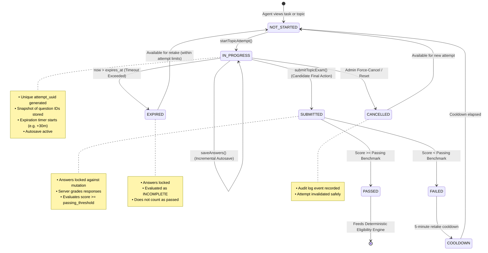
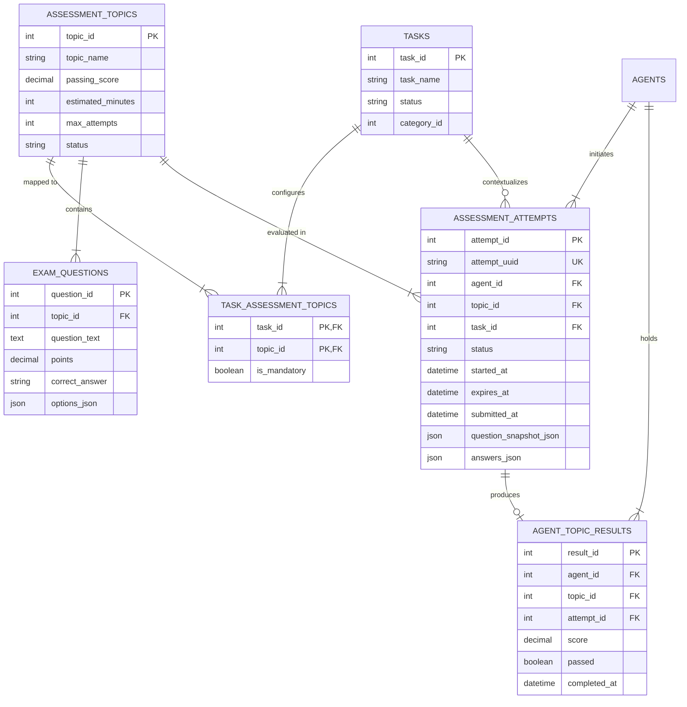

# VERIFYMESH — ASSESSMENT ARCHITECTURE AND BUSINESS RULES

**Document Version:** 1.0.0  
**Status:** Architecture Blueprint (Phase 1 Deliverable)  
**Author:** Senior Software Architect, Backend Security Engineer & Assessment Systems Specialist  
**Target Subsystem:** VerifyMesh Deterministic Assessment & Qualification Framework  

---

## 1. Domain Model: The Nine Core Assessment Concepts

To prevent ambiguity between attempts, scores, and overarching eligibility, VerifyMesh strictly isolates nine distinct domain entities:

```
┌─────────────────────────────────────────────────────────────────────────────┐
│                             DOMAIN TAXONOMY                                 │
└─────────────────────────────────────────────────────────────────────────────┘

 [ Task Requirement ] ──► Configures mandatory/optional competencies for a task
        │
        ▼
 [ Assessment Topic ] ──► Individual competency area (e.g., Customer Communication)
        │
        ├─► [ Question ] ────────► Scenario prompt belonging to a topic
        │        │
        │        ├─► [ Answer Option ] ──► Distractor or correct option (A, B, C, D)
        │        └─► [ Correct Answer ] ─► Server-only answer key (NEVER client-exposed)
        │
        ▼
 [ Assessment Attempt ] ─► One agent's active or finalized sitting for a topic/exam
        │
        ├─► [ Assessment Response ] ──► Candidate's selected option identifier
        └─► [ Assessment Result ] ────► Graded score, pass/fail status, timestamp
```

### Formal Entity Definitions

1. **Assessment:**  
   The high-level evaluation instrument or exam package (represented historically by `exams`). In the modern VerifyMesh architecture, an assessment is a modular collection of one or more **Assessment Topics**.
2. **Assessment Topic:**  
   A discrete, measurable competency dimension (represented by `assessment_topics`, e.g., *Product Knowledge*, *Customer Communication*, *Sales Techniques*, *Customer Relationship Management*). Every topic defines its own passing threshold, estimated completion time, and active status.
3. **Question:**  
   An atomic scenario-based multiple-choice evaluation unit (represented by `exam_questions`). Every question belongs to exactly one topic, carries a point weight (typically 1.00), and presents a set of answer options.
4. **Answer Option:**  
   A selectable response alternative presented to the candidate. Each option possesses an internal key and descriptive text. Display labels (`A`, `B`, `C`, `D`) are dynamically mapped per attempt to prevent pattern recognition.
5. **Correct Answer:**  
   The authoritative server-side answer key. It is stored exclusively in the database and is never transmitted to the client application under any circumstances.
6. **Assessment Attempt:**  
   A single, time-bounded sitting initiated by an authenticated agent (represented by `assessment_attempts`). It tracks the lifecycle state (`IN_PROGRESS`, `SUBMITTED`, `EXPIRED`, `CANCELLED`), authoritative start and expiration timestamps, attempt sequence number, and context (`topic_id`, `task_id`).
7. **Assessment Response:**  
   A candidate's recorded answer selection for a specific question within an active attempt. Responses are incrementally captured via autosave and finalized upon submission.
8. **Assessment Result:**  
   The immutable, server-graded outcome of a finalized attempt (represented in `agent_topic_results` and `exam_results`). It records the numerical score percentage, binary qualification decision (`Passed` / `Failed`), and completion timestamp.
9. **Task Requirement:**  
   The qualification specification attached to a work opportunity (represented in `task_requirements` and `task_assessment_topics`). It establishes which assessment topics are mandatory versus optional, alongside required work experience and professional certifications.

---

## 2. Assessment Lifecycle & State Machine

A critical flaw in legacy assessment engines is conflating the **Attempt Lifecycle Status** (how the candidate interacts with the session) with the **Assessment Result Status** (whether the performance met the passing benchmark). VerifyMesh decouples these states completely.

### State Transition Diagram



### State Definitions & Invariants

| State | Scope | Description | Invariants |
| :--- | :--- | :--- | :--- |
| **NOT_STARTED** | Initial | Candidate has not initiated an attempt for the topic/task. | No active attempt row exists with `status = 'IN_PROGRESS'`. |
| **IN_PROGRESS** | Attempt Lifecycle | Candidate is actively taking the assessment. | Answers can be updated via autosave. `now <= expires_at`. Cannot apply for task. |
| **SUBMITTED** | Attempt Lifecycle | Candidate has submitted answers for server-side evaluation. | Attempt is permanently locked. No further answer modifications allowed. |
| **EXPIRED** | Attempt Lifecycle | Permitted time window elapsed before candidate submitted. | Answers locked. Marked incomplete. Must not silently become a passed result. |
| **CANCELLED** | Attempt Lifecycle | An authorized Administrator invalidated the attempt. | Reason recorded in `audit_logs`. Result excluded from eligibility calculations. |
| **PASSED** | Assessment Result | Graded score satisfies or exceeds configured benchmark. | Meets task prerequisite: `topic_status = 'Passed'`. |
| **FAILED** | Assessment Result | Graded score is below configured benchmark. | Blocks task eligibility: `topic_status = 'Failed'`. Triggers cooldown timer. |

---

## 3. Assessment-to-Task Relationship Architecture

In the unified architecture, tasks require specific **Competency Topics** rather than a single rigid monolithic exam. This eliminates the defect where Task 2 required three topics but had a single legacy foreign key `tasks.exam_id = 3`.

### Entity-Relationship Diagram



### Relational Rules
1. **Authoritative Mapping:** `task_assessment_topics` is the sole source of truth for task qualification. Legacy `tasks.exam_id` is deprecated and maintained strictly for backwards-compatible foreign key constraints.
2. **Multi-Topic Tasks:** A task may configure $N$ required topics (e.g. Enterprise Onboarding Lead requires Topics 1, 3, and 4). Every mandatory topic must independently achieve `passed = 1`.
3. **Cross-Task Topic Portability:** If an agent demonstrates competency by passing *Customer Communication* ($\ge 75\%$) for Task 4, that passed result automatically satisfies the *Customer Communication* requirement for Task 2, provided the result has not expired or been reset.
4. **Task-Contextual Attempts:** When an attempt is launched from a task card, `task_id` is permanently recorded on `assessment_attempts` for audit traceability.

---

## 4. Configurable Assessment Rules & Policies

VerifyMesh mandates that all evaluation parameters are dynamically configurable rather than hardcoded in source code:

| Rule Dimension | Configuration Source | Default Value | Enforcement Mechanism |
| :--- | :--- | :--- | :--- |
| **Passing Benchmark** | `assessment_topics.passing_score` | `70.00%` – `75.00%` | Server compares $\text{score} \ge \text{passing\_score}$. Values $< 0$ or $> 100$ rejected. |
| **Mandatory vs. Optional** | `task_assessment_topics.is_mandatory` | `1` (Mandatory) | Mandatory topics block application if unpassed. Optional topics inform suitability without blocking. |
| **Attempt Duration** | `assessment_topics.estimated_minutes` or `Config` | `30 minutes` | `expires_at = started_at + duration`. Validated server-side on every request. |
| **Retake Cooldown** | `Config.ASSESSMENT_COOLDOWN_SECONDS` | `300 seconds` (5m) | Checked via `check_agent_assessment_cooldown()` against latest submitted attempt. |
| **Maximum Permitted Attempts** | `assessment_topics.max_attempts` | `3 attempts` | New attempt rejected with HTTP 403 once maximum attempts reached without passing. |
| **Question Point Values** | `exam_questions.points` | `1.00 point` | Proportional scoring: $\text{Score} = \frac{\sum \text{Earned Points}}{\sum \text{Possible Points}} \times 100$. |
| **Incomplete Attempt Outcome** | Assessment Policy | `INCOMPLETE` | Expired attempts receive no passing score. Must not be treated as 0% penalty nor 100% pass. |

---

## 5. Eligibility Engine Integration & Separation of Concerns

The deterministic Eligibility Engine and the Machine Learning Advisory Model have strictly non-overlapping boundaries:

```
┌─────────────────────────────────────────────────────────────────────────────┐
│                    DETERMINISTIC ELIGIBILITY ENGINE                         │
│                    (Server-Authoritative Gatekeeper)                        │
└──────────────────────────────────────┬──────────────────────────────────────┘
                                       │
     Checks:                           │
     • Account active?                 │
     • Mandatory certs verified?       │
     • Verified experience >= min?     │
     • ALL mandatory topics PASSED?    ▼
 ┌─────────────────────────────────────────────────────────────────────────────┐
 │                         CAN THE AGENT APPLY?                                │
 │   NO  ──► Set task.can_apply = False (Surfaces blocking reason)             │
 │   YES ──► Set task.can_apply = True  (Surfaces 'Apply Now' action)          │
 └──────────────────────────────────────┬──────────────────────────────────────┘
                                        │
                                        ▼ (Only after application is submitted)
 ┌─────────────────────────────────────────────────────────────────────────────┐
 │                    STAGE 2 ML SUITABILITY MODEL                             │
 │                    (Advisory Decision-Support Only)                         │
 ├─────────────────────────────────────────────────────────────────────────────┤
 │ • Takes verified profile features + task competency requirements            │
 │ • Predicts suitability probability (0.0% – 100.0%)                          │
 │ • Provides SHAP-style explainability breakdown for Workforce Officers       │
 │                                                                             │
 │ STRICT CONSTRAINTS:                                                         │
 │ 1. ML cannot grade questions or compute assessment scores.                  │
 │ 2. ML cannot override a failed mandatory assessment.                       │
 │ 3. ML cannot convert an ineligible applicant into an eligible applicant.    │
 │ 4. Final assignment authority rests exclusively with the Human Admin.       │
 └─────────────────────────────────────────────────────────────────────────────┘
```

### Deterministic Application Submission Rules:
When an agent calls `POST /api/competency/tasks/:id/apply`:
1. Re-evaluate `get_agent_tasks_with_eligibility(user_id)` independently.
2. If `can_apply` is `False`, reject with `HTTP 400 Bad Request` citing the authoritative `blocking_reason`.
3. If `exam_required` is true and any mandatory topic has `status != 'Passed'`, reject immediately.
4. If an existing application row is present in `task_applications`, reject duplicate submission.

---

## 6. Administrative Governance, Reset & Audit Logging

### Audit Logging Requirements
Every critical lifecycle event must insert a structured, immutable entry into `audit_logs`:

| Event Action | Trigger | Captured Metadata |
| :--- | :--- | :--- |
| `ASSESSMENT_ATTEMPT_STARTED` | Candidate launches attempt | `user_id`, `attempt_id`, `topic_id`, `task_id`, `started_at`, `expires_at` |
| `ASSESSMENT_ATTEMPT_SUBMITTED` | Candidate submits answers | `user_id`, `attempt_id`, `score`, `passed`, `duration_seconds` |
| `ASSESSMENT_ATTEMPT_EXPIRED` | Timeout exceeded | `user_id`, `attempt_id`, `topic_id`, `expires_at` |
| `ASSESSMENT_RESET_AUTHORIZED` | Administrator resets agent | `admin_user_id`, `target_agent_id`, `reason`, `prior_attempt_count` |
| `TASK_APPLICATION_SUBMITTED` | Candidate applies for task | `user_id`, `task_id`, `verified_experience_months`, `topic_scores_json` |

### Authorized Reset Policy
- **Agent Self-Reset Forbidden:** The existing endpoint `POST /api/competency/reset-assessment` must be removed from agent access.
- **Admin-Controlled Reset:** Resets must require Workforce Officer credentials (`POST /api/admin/agents/:id/reset-assessment`).
- **Audit Mandate:** Every reset must provide a non-empty `reason` string, preserving all historical rows in `assessment_attempts` and `agent_topic_results`.

---

## 7. Outstanding Decisions for User Approval

Before initiating schema changes in Phase 2, the following design decisions are submitted for approval:

1. **Prerequisite Evaluation Precedence:**  
   *Current behavior:* `not has_assessment_completed` is checked before `not meets_exp`, causing candidates with 0 months experience to be urged to "Take Assessment" for tasks requiring 24 months experience.  
   *Recommended change:* Check hard credentials (Certifications and Minimum Experience) **before** prompting for assessment. If experience is lacking, state displays `Requires X Months Exp` and button displays `View details →`.  
   *Options:* (A) Implement recommended experience-first gate; (B) Retain current assessment-first funnel.

2. **Maximum Permitted Attempts Quota:**  
   *Recommendation:* Enforce a limit of **3 attempts** per competency topic. If a candidate fails 3 times, further attempts are locked pending administrative unlock.  
   *Options:* (A) Enforce 3-attempt quota; (B) Allow unlimited retakes governed only by the 5-minute cooldown.

3. **Incomplete / Expired Attempt Policy:**  
   *Recommendation:* Expired attempts are marked `EXPIRED` with `score = NULL, passed = 0`. They count toward the attempt quota to prevent question harvesting, but do not contribute a negative zero-score to historical averages.  
   *Options:* (A) Mark as Incomplete/Expired (No score penalty); (B) Score partially answered questions as a final submission upon expiry.

---

**Status:** Phase 1 Architecture Blueprint Complete. Zero schema or code modifications executed.  
**Action Required:** STOP and review the architecture specification and outstanding decisions for approval.

