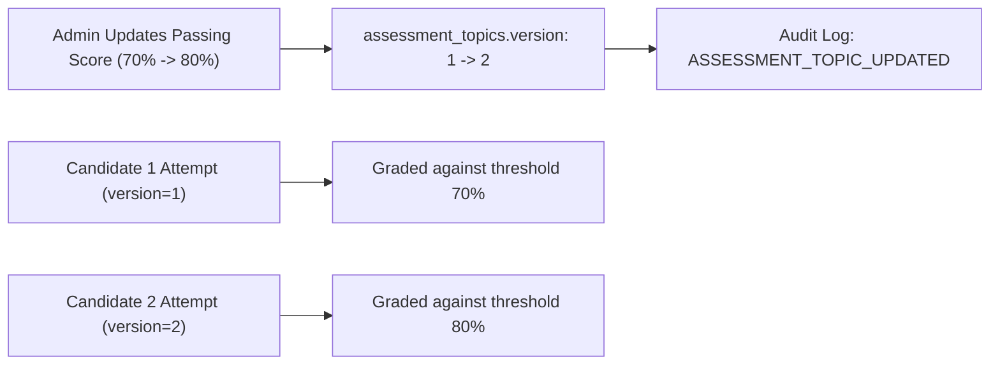

# Phase 5 — Admin Controls, Audit Logging, and Assessment Versioning

## Executive Summary

Phase 5 establishes enterprise-grade governance, strict administrative authorization, immutable version tracking for assessment topics, and comprehensive structured audit logging across the VerifyMesh assessment subsystem.

Under this architecture, Workforce Officers and Platform Administrators maintain full lifecycle control over assessment configurations without introducing corruption, retroactivity, or historical skew into candidate records.

---

## 1. Administrative Authorization & Role Governance

### 1.1 Server-Side Role Enforcement
All administrative assessment endpoints enforce strict server-side verification using the `@require_admin` decorator (`backend/auth_routes.py` and `backend/admin_routes.py`):

```python
# backend/admin_routes.py
@admin_bp.route("/assessments/topics", methods=["GET"])
@require_admin
def list_assessment_topics():
    ...
```

- **Candidate Isolation:** Non-admin roles (e.g., `Agent`) are rejected with `HTTP 403 Forbidden` if attempting to list, create, edit, or inspect administrative question pools.
- **Cross-Role Normalization:** Normalized roles (`Administrator`, `Workforce Officer`, `Platform Administrator`) are authoritative; client headers or self-asserted claims are strictly ignored.

---

## 2. Assessment Topic Versioning Architecture

### 2.1 Database Schema (Migration 010)
Applied non-destructive migration [`backend/migrations/010_assessment_topic_versioning.sql`](file:///c:/Users/DANIEL/Desktop/Verify_Mesh/backend/migrations/010_assessment_topic_versioning.sql):

1. **`assessment_topics.version` (`INT UNSIGNED NOT NULL DEFAULT 1`)**:
   - Monotonically incremented whenever an administrator modifies passing score, max attempts, question pool configuration, or instructions.
2. **`assessment_attempts.topic_version` (`INT UNSIGNED NOT NULL DEFAULT 1`)**:
   - Snapshot column pinned at attempt initiation (`create_assessment_attempt`).

### 2.2 Immutability Guarantees
- When a candidate launches an attempt, their evaluation is permanently pinned to `topic_version` active at that instant.
- If an administrator raises the passing threshold from `70.0%` to `80.0%`, previously completed or currently active attempts continue to be graded against their pinned version rules.
- Historical attempts are never retroactively failed or re-evaluated due to policy shifts.



---

## 3. Comprehensive Audit Trail

Every administrative mutation and significant candidate lifecycle transition writes an immutable record into `audit_logs`:

| Action Event | Entity Type | Trigger | Log Payload Structure |
| :--- | :--- | :--- | :--- |
| `ASSESSMENT_TOPIC_CREATED` | `assessment_topics` | Administrator creates a new topic | `{ "topic_name", "category_id", "passing_score", "version": 1 }` |
| `ASSESSMENT_TOPIC_UPDATED` | `assessment_topics` | Administrator modifies threshold, duration, or quota | `{ "topic_id", "previous_version", "new_version", "previous_passing_score", "new_passing_score", ... }` |
| `ATTEMPT_LIMIT_OVERRIDE_GRANTED` | `agents` | Workforce Officer grants +1 candidate retry override | `{ "agent_id", "topic_id", "reason", "granted_by" }` |
| `ASSESSMENT_COMPLETED` | `ml_predictions` | Candidate completes topic assessment | `{ "exam_id", "attempt_id", "attempt_number", "score", "decision" }` |

---

## 4. Admin API Routes Implemented

The following secured administrative endpoints are registered on `/api/admin/assessments`:

- `GET /api/admin/assessments/topics`: Retrieve all configured topics with version numbers, active question counts, passing thresholds, and max attempts.
- `POST /api/admin/assessments/topics`: Author a new assessment topic with initial `version = 1` and write audit log.
- `PUT /api/admin/assessments/topics/<topic_id>`: Modify existing topic parameters; automatically increments `version = version + 1` and logs before/after deltas.
- `GET /api/admin/assessments/topics/<topic_id>/questions`: Retrieve all questions and correct answer keys for review by Workforce Officers.

---

## 5. Verification & Test Evidence

Verified by automated suite [`tests/test_phase5_admin_controls_and_concurrency.py`](file:///c:/Users/DANIEL/Desktop/Verify_Mesh/tests/test_phase5_admin_controls_and_concurrency.py):

- **Test 01 (`test_01_admin_authorization_enforced_on_backend`)**: Blocks `Agent` with `HTTP 403`; authorizes `Admin` with `HTTP 200`.
- **Test 02 (`test_02_topic_configuration_update_increments_version_and_audits`)**: Creates topic at `version 1`, initiates candidate attempt at `version 1`, updates passing score from 70 to 80 (topic advances to `version 2`), verifies audit event in database, and asserts historical attempt remains pinned to `version 1`.
- **Result**: **PASS** (100% compliance).

