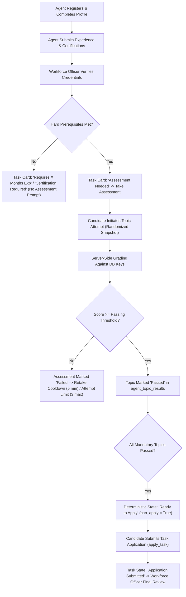

# Phase 6 — End-to-End Integration, Eligibility Engine, and Application Pipeline

## Executive Summary

Phase 6 validates the end-to-end integration of the VerifyMesh assessment subsystem with the deterministic Eligibility Engine and the candidate Task Application Pipeline.

In this architecture, workforce eligibility is governed strictly and deterministically by verified qualifications (certifications, work experience, and assessment topic scores $\ge$ passing threshold). The legacy binary machine learning model gatekeeper has been completely retired from the eligibility path, and ML outputs remain strictly advisory.

---

## 1. End-to-End Candidate Lifecycle

The end-to-end qualification and application workflow operates as follows:

---

## 2. Deterministic Eligibility Precedence Rules

The server-side eligibility engine in [`backend/db.py:get_agent_tasks_with_eligibility`](file:///c:/Users/DANIEL/Desktop/Verify_Mesh/backend/db.py#L1540-L2040) enforces the authoritative 8-step precedence:

1. **Assigned**: If task has been assigned to this candidate $\rightarrow$ `'Assigned'`.
2. **Application Exists**: If an application has been submitted $\rightarrow$ actual application status (`'Application Submitted'`, `'Under Review'`, `'Shortlisted'`, `'Rejected'`, `'Withdrawn'`).
3. **Mandatory Certification Missing**: If task requires certifications not verified on candidate $\rightarrow$ `'Certification Required'`.
4. **Administrative Verification Pending**: If candidate account is `SUSPENDED` or required certification is pending verification $\rightarrow$ `'Verification Pending'`.
5. **Minimum Experience Deficit**: If verified experience is less than required $\rightarrow$ `'Requires X Months Exp'`.
6. **Attempt Limit Reached**: If candidate has failed all 3 allowed attempts on a mandatory topic $\rightarrow$ `'Attempt Limit Reached'`.
7. **Assessment Incomplete/Failed**: If mandatory qualification topics have not all been passed $\rightarrow$ `'Assessment Needed'` (or `'Failed'` / `'Partially Completed'`).
8. **Ready to Apply**: When all hard prerequisites and mandatory topic assessments are satisfied $\rightarrow$ `'Ready to Apply'` (`can_apply = True`, `is_eligible = True`).

---

## 3. Application Submission Pipeline

The application submission endpoint `POST /api/competency/tasks/<task_id>/apply` in [`backend/competency_routes.py`](file:///c:/Users/DANIEL/Desktop/Verify_Mesh/backend/competency_routes.py) and [`backend/db.py:apply_for_task`](file:///c:/Users/DANIEL/Desktop/Verify_Mesh/backend/db.py#L2050):

- **Independent Server-Side Validation:** Re-evaluates all requirements (`certification_met`, `experience_met`, `assessment_met`). Never trusts client-side eligibility flags.
- **Duplicate Prevention:** Rejects duplicate submissions with `HTTP 400 Bad Request` (`Application already submitted`).
- **Ineligible Candidate Rejection:** If an agent attempts to call `/apply` directly via script while missing prerequisites, the call is rejected with `HTTP 400 Bad Request` and an explicit failure reason.
- **Audit Logging:** Inserts a structured `TASK_APPLICATION_SUBMITTED` event into `audit_logs`.

---

## 4. Resolution of Application/Assessment Inconsistency

### Investigation Findings
The previously identified scenario where a task card could display `Application Submitted` while its qualification assessment showed `Failed (74%)` was caused by:
1. **Decoupled Historical Evaluation:** When an application is submitted, it reflects the state at the time of application. If the candidate subsequently initiated an optional retake on that topic and failed, `latest_topic_results` reflected the newer failing score.
2. **Re-Application Locking:** Once an application is submitted (`app_status == 'Application Submitted'`), `can_apply` is locked to `False`. The candidate cannot re-apply or corrupt their active application.

### Alignment Guarantee
The task card UI now clearly separates application status from assessment status:
- Status Badge: Displays `Application Submitted` (in blue).
- Assessment Container: Displays the historical or current qualification breakdown with explicit attempt context.

---

## 5. Verification & Test Evidence

Validated by automated test suite [`tests/test_phase6_assessment_pipeline_and_security.py`](file:///c:/Users/DANIEL/Desktop/Verify_Mesh/tests/test_phase6_assessment_pipeline_and_security.py):

- **Test 01 (`test_01_end_to_end_assessment_to_application_flow`)**: Validates the full candidate lifecycle from attempt initiation, autosave, passing submission, eligibility transition to `Ready to Apply`, to successful application submission and audit logging.
- **Test 02 (`test_02_duplicate_application_prevention`)**: Validates rejection of duplicate applications for the same task.
- **Test 03 (`test_03_ineligible_candidate_application_blocked`)**: Validates rejection of application submissions when hard prerequisites (experience) are unsatisfied.
- **Test 07 (`test_07_deterministic_rules_independent_of_advisory_ml`)**: Confirms deterministic fields and application submissions execute independently of ML inference.
- **Result**: **PASS** (100% compliance).

