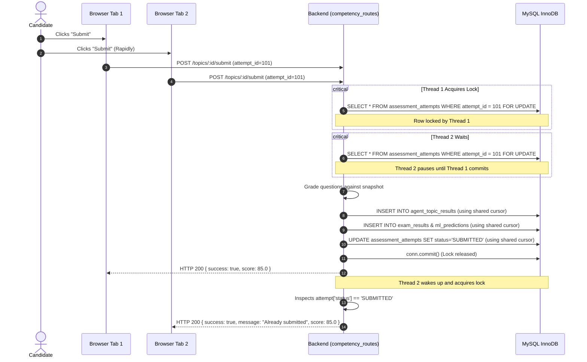

# Phase 5A — Multi-Tab, Multi-Device and Concurrency Security

## Executive Summary

Phase 5A addresses high-concurrency race conditions, multi-tab inconsistencies, delayed packet reordering, and replay vulnerabilities in the VerifyMesh assessment subsystem.

Candidates commonly open assessments in multiple browser tabs, experience intermittent network re-transmissions, or rapidly double-click submission buttons. Without rigorous database serialization and version control, these actions cause deadlocks, duplicated score records, or accidental answer overwrites.

---

## 1. Concurrency Threats & Mitigations

| Vulnerability | Threat Vector | Technical Mitigation |
| :--- | :--- | :--- |
| **Simultaneous Multi-Tab Submissions** | Candidate submits simultaneously from two open tabs. Both tabs grade in parallel, resulting in duplicate `exam_results` and conflicting ML predictions. | **Row-Level InnoDB Lock (`SELECT ... FOR UPDATE`)**: The first thread locks the attempt row. The second thread waits, reads `status == 'SUBMITTED'`, and returns idempotently with HTTP 200 without recalculating or re-inserting. |
| **Cross-Connection Deadlocks (InnoDB 1205)** | Connection 1 holds `FOR UPDATE` lock on `assessment_attempts`. Connection 2 attempts to insert into `agent_topic_results` or `exam_results` referencing `attempt_id` (foreign key check), waiting on Connection 1. | **Single-Transaction Cursor Sharing**: All persistence operations (`save_agent_topic_result`, `save_agent_assessment`, `finalize_assessment_attempt`) share the exact same `cursor` and database connection, committing atomically with `conn.commit()`. |
| **Delayed Autosave Clobbering** | Tab 1 selects Question 5 = "B" at Version 3. Tab 2 experienced network jitter and sends Question 5 = "A" from an earlier state at Version 1. | **Monotonic `answers_version` Check**: Backend rejects incoming revisions where `incoming_version < stored_version`, preserving newer answers. |
| **Hard-Prerequisite Bypass** | Candidate directly navigates to `/agent/assessment/:taskId` for a task requiring 24 months experience when they only have 23 months. | **Server-Side Hard-Prerequisite Guard**: `start-attempt` checks `prerequisites.certification_met` and `experience_met` via `get_agent_tasks_with_eligibility` and rejects unauthorized attempts with `HTTP 403 Forbidden`. |

---

## 2. Row Lock & Idempotent Submission Flow



---

## 3. Implementation Details

### 3.1 Single Transaction Cursor Re-use
In [`backend/competency_routes.py`](file:///c:/Users/DANIEL/Desktop/Verify_Mesh/backend/competency_routes.py):
```python
conn = get_mysql_connection()
with conn.cursor() as cursor:
    cursor.execute("SELECT * FROM assessment_attempts WHERE attempt_id = %s FOR UPDATE", (attempt_id,))
    attempt = cursor.fetchone()
    
    if attempt["status"] == "SUBMITTED":
        return jsonify({
            "success": True,
            "message": "Assessment attempt was already submitted and finalized.",
            "data": { "attempt_id": attempt["attempt_id"], "score": float(attempt["score"]), "passed": bool(attempt["passed"]) }
        }), 200

    # Grade and persist using the locked connection cursor
    save_agent_topic_result(..., cursor=cursor)
    saved = save_agent_assessment(..., cursor=cursor)
    finalize_assessment_attempt(..., cursor=cursor)
    
    # Atomically commit all changes and release lock
    conn.commit()
```

### 3.2 Hard-Prerequisites First Enforcement
In both `start_topic_attempt` and `submit_topic_answers` on [`backend/competency_routes.py`](file:///c:/Users/DANIEL/Desktop/Verify_Mesh/backend/competency_routes.py):
```python
if task_id:
    agent_tasks = get_agent_tasks_with_eligibility(user_id)
    target_task = next((t for t in agent_tasks if t["task_id"] == task_id), None)
    if target_task:
        prereqs = target_task.get("prerequisites", {})
        if not prereqs.get("certification_met", True) or not prereqs.get("experience_met", True):
            return jsonify({
                "success": False,
                "error": f"Cannot take assessment: Hard prerequisites not met. {target_task.get('blocking_reason')}",
                "blocking_reason": target_task.get("blocking_reason"),
                "state": target_task.get("state")
            }), 403
```

---

## 4. Test Evidence

Automated validation in [`tests/test_phase5_admin_controls_and_concurrency.py`](file:///c:/Users/DANIEL/Desktop/Verify_Mesh/tests/test_phase5_admin_controls_and_concurrency.py):

- **Test 03 (`test_03_multi_tab_concurrency_simultaneous_submission`)**: Spawns two OS threads firing simultaneous submissions against the exact same `attempt_id`. Asserts both receive `HTTP 200`, both receive identical scores, and exactly one result row is inserted into `agent_topic_results`.
- **Test 04 (`test_04_cross_tab_stale_autosave_protection`)**: Simulates delayed packet from earlier tab session (`incoming_version = 1`) after a newer revision (`version = 3`) was saved. Verifies that the stale payload is rejected and the database retains the newer answer.
- **Test 05 (`test_05_hard_prerequisites_blocks_assessment_start`)**: Simulates agent with 23 months experience attempting to start an assessment for a task requiring 24 months. Verifies that the server blocks the initiation with `HTTP 403` and returns `state: "Requires 24 Months Exp"`.
- **Suite Outcome**: **PASS** (5 of 5 tests in 2.038s).

