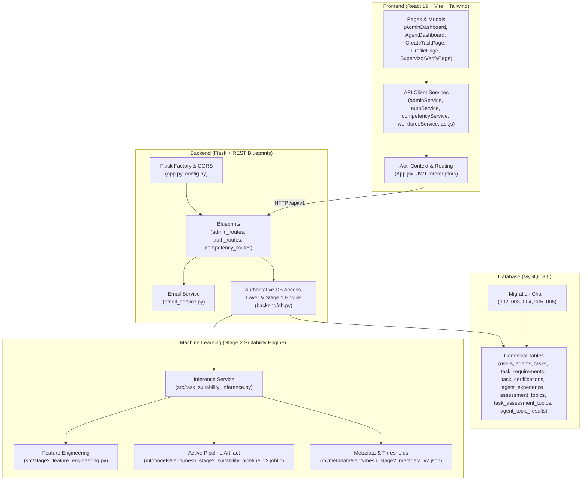

# VERIFYMESH — PHASE 0.3: DEPENDENCY AND LEGACY CODE AUDIT

**Date:** 2026-11-09  
**Repository:** VerifyMesh (`VerifyMesh-ML`)  
**Auditor:** Senior Software & ML Engineering Lead / Repository Maintainer  
**Status:** PHASE 0.3 COMPLETED — AWAITING REVIEW & APPROVAL  

---

## 1. COMPONENT DEPENDENCY MAP

---

## 2. ACTIVE APPLICATION EXECUTION FLOW

### Stage 1: Deterministic Eligibility Verification (Mandatory Gatekeeper)
1. **Agent Profile & Credential Submission:**  
   - Agent registers (`RegisterForm.jsx` $\rightarrow$ `/api/auth/register` $\rightarrow$ `backend/db.py:create_user_and_agent`).
   - Agent submits employment history (`ProfilePage.jsx` $\rightarrow$ `/api/auth/agent/experience` $\rightarrow$ `backend/db.py:create_agent_experience`).
   - Supervisor verifies employment tenure via 1-click tokenized email link (`SupervisorVerifyPage.jsx` $\rightarrow$ `/api/auth/references/verify/<token>` $\rightarrow$ `backend/db.py:verify_supervisor_reference`).
   - Admin validates certifications (`AdminDashboard.jsx` $\rightarrow$ `/api/admin/certifications/<id>/verify` $\rightarrow$ `backend/db.py:verify_agent_certification`).
2. **Deterministic Task Eligibility Evaluation:**  
   - Agent requests available tasks (`AgentDashboard.jsx` $\rightarrow$ `/api/competency/tasks/available` $\rightarrow$ `backend/db.py:get_agent_tasks_with_eligibility`).
   - `backend/db.py` checks:
     - Verified experience: $\text{agent\_exp} \ge \text{task\_min\_exp}$
     - Multi-certifications: Agent must possess all active certifications linked in `task_certifications`.
     - Assessment topics: Agent must have passed all mandatory topics linked in `task_assessment_topics` with score $\ge 70\%$.
   - If any requirement is missing, `is_eligible = False` and `can_apply = False`, with specific blocking reason provided.

### Stage 2: Advisory Task Suitability Prediction (Post-Application ML Scoring)
1. **Application Submission:**  
   - Only eligible agents can apply (`TaskModal.jsx` $\rightarrow$ `/api/competency/tasks/<id>/apply` $\rightarrow$ `backend/db.py:apply_for_task`).
2. **Workforce Officer Review:**  
   - Workforce Officer opens task applicant review (`AdminDashboard.jsx` $\rightarrow$ `/api/admin/tasks/<id>/applicants` $\rightarrow$ `backend/db.py:get_task_applicants`).
3. **Advisory ML Inference:**  
   - For eligible applicants, `get_task_applicants` invokes `build_task_suitability_features()`.
   - `task_suitability_engine.predict()` applies the 5-feature schema (`weighted_skill_margin`, `min_skill_margin`, `weakest_link_deficit`, `exp_surplus_tanh`, `difficulty_tier`).
   - Standardized via `StandardScaler` and evaluated with L2-regularized Logistic Regression ($C=0.5$).
   - Outputs calibrated probability, advisory tier (*Strong Fit*, *Moderate Fit*, *Needs Review*), and feature contribution factors.
4. **Final Decision Authority:**  
   - The Administrator retains complete final authority to allocate or decline candidates.

---

## 3. COMPLETE STAGE 2 MODEL LINEAGE & INFERENCE DEPENDENCY MAP

| Pipeline Step | Authoritative File | Artifact / Data Source | Verified Status |
|---|---|---|---|
| **1. Simulation Generation** | `ml/experiments/task_specific_synthetic_data/generate_synthetic_dataset.py` | Produces `synthetic_applicants.csv`, `synthetic_tasks.csv`, `synthetic_applicant_task_pairs.csv` | Verified (Deterministic seed 42) |
| **2. Scenario B Partitioning** | `ml/experiments/stage2_refinement/scenario_b_data/` | `task_suitability_training.csv` (N=4,675 eligible pairs, strict bottleneck) | Verified (SHA-256: `5492d207...`) |
| **3. Feature Engineering** | `src/stage2_feature_engineering.py` | Defines `STAGE2_V2_FEATURES`, `resolve_domain_weights()`, `compute_stage2_features_dataframe()` | Verified (Used in training & inference) |
| **4. Training & Calibration** | `ml/experiments/stage2_refinement/train_and_serialize_stage2_v2.py` | Evaluates 5-seed x 5-fold StratifiedGroupKFold, fits `ColumnTransformer(StandardScaler) + LogisticRegression(C=0.5)` | Verified |
| **5. Saved Model Artifact** | `ml/models/verifymesh_stage2_suitability_pipeline_v2.joblib` | 2.6 KB joblib binary (SHA-256: `96361a68...`) | Verified (Loads cleanly in scikit-learn 1.6/1.9) |
| **6. Model Metadata** | `ml/metadata/verifymesh_stage2_metadata_v2.json` | Advisory threshold 0.60, moderate threshold 0.48, tier rules | Verified |
| **7. Runtime Inference** | `src/task_suitability_inference.py` | `task_suitability_engine.predict(feature_dict)` | Verified (Full validation & explainability) |
| **8. UI Consumption** | `frontend/src/pages/AdminDashboard.jsx` | Renders advisory tiers, probability badges, and contributing factor cards | Verified |

### Preprocessing Consistency Verification
- Training: `ColumnTransformer([('scaler', StandardScaler(), ['weighted_skill_margin', 'min_skill_margin', 'weakest_link_deficit', 'exp_surplus_tanh', 'difficulty_tier'])])`.
- Inference: Loaded model pipeline executes the exact fitted `ColumnTransformer` and `StandardScaler` from training. No re-fitting occurs on single instances.
- Order and names of features: 100% identical.

---

## 4. LEGACY BINARY MODEL DEPENDENCY ANALYSIS

| Legacy Asset | Previous Purpose | Active System Reference | Impact of Permanent Removal | Recommendation |
|---|---|---|---|---|
| `backend/models/binary_eligibility_model.pkl` (3.45 MB) | Trained Random Forest classifier for binary competency qualification | Referenced as historical comparison in `ml/experiments/stage2_refinement/run_phase3_final_audit.py` | Breaks historical Phase 3 benchmark audit script if deleted. Not used by production routes. | **ARCHIVE** (`archive/legacy_binary_gatekeeper/`) |
| `src/inference.py` | Inference wrapper for `binary_eligibility_model.pkl` | **Directly imported in `tests/test_system_suite.py:53`** | **CRITICAL: Breaks `test_system_suite.py`** because test cases `test_TC009`–`test_TC013` assert legacy binary predictions. | **REFACTOR TEST SUITE & ARCHIVE** |
| `data/raw/VerifyMesh_Competency_Dataset_V2.csv` (116 KB) | 2,000-row synthetic competency training dataset | Referenced in historical thesis drafts and legacy evaluation notes | Zero runtime impact; academic reproducibility value only. | **ARCHIVE** (`archive/legacy_binary_gatekeeper/`) |
| `ml/train.py` | CLI training script for binary model | None in active production | Zero runtime impact; historical baseline code. | **ARCHIVE** (`archive/legacy_binary_gatekeeper/`) |
| `ml/evaluate.py` | CLI evaluation script for binary model | None in active production | Zero runtime impact; historical baseline code. | **ARCHIVE** (`archive/legacy_binary_gatekeeper/`) |
| `ml/notebooks/Verify_Mesh.ipynb` | Jupyter notebook for initial binary model | None in active production | Historical academic artifact. | **ARCHIVE** (`archive/legacy_binary_gatekeeper/`) |

---

## 5. DATABASE MIGRATION DEPENDENCY ANALYSIS

| Migration | Key DDL / Tables Added | Idempotency | Included in `schema.sql`? | Rollback Procedure |
|---|---|---|---|---|
| **002** | `assessment_attempts` table | **YES** (`CREATE TABLE IF NOT EXISTS`, tracked in `schema_migrations`) | **YES** | `DROP TABLE IF EXISTS assessment_attempts;` |
| **003** | `assessment_topics`, `task_assessment_topics`, `agent_topic_results` | **YES** (`CREATE TABLE IF NOT EXISTS`, tracked in `schema_migrations`) | **PARTIAL (`agent_topic_results` is MISSING in `schema.sql`)** | `DROP TABLE IF EXISTS agent_topic_results, task_assessment_topics, assessment_topics;` |
| **004** | Extends `ml_predictions.predicted_competency` & `task_requirements.minimum_competency` ENUMs to include `'ELIGIBLE'` | **YES** (`ALTER TABLE ... MODIFY COLUMN` is re-runnable) | **YES** | Revert ENUM column definitions to legacy list. |
| **005** | Adds supervisor verification columns to `agent_experience` | **YES** (`migrate_005...` inspects `DESCRIBE agent_experience` before `ADD COLUMN`) | **YES** | `ALTER TABLE agent_experience DROP COLUMN supervisor_name, ...;` |
| **006** | `task_certifications` table and backfill from `task_requirements` | **YES** (`CREATE TABLE IF NOT EXISTS` + `INSERT IGNORE`) | **YES** | `DROP TABLE IF EXISTS task_certifications;` |

### Critical Database Finding
`backend/schema.sql` currently **does not include** `agent_topic_results` (from Migration 003). If a new developer initializes a blank MySQL database by running `schema.sql` directly without executing `migrate_003_assessment_topics_framework.py`, the assessment topic scoring queries will fail with `Table 'verifymesh_db.agent_topic_results' doesn't exist`. `schema.sql` must be updated to include `agent_topic_results`.

---

## 6. LARGE FILES STRUCTURAL AUDIT

| File | Lines | Size | Structure & Duplication Analysis | Recommendation |
|---|---|---|---|---|
| `backend/db.py` | 4,630 | 220 KB | Contains 65 top-level functions. **61 of 65 functions are actively called** across routes and tests. The remaining 4 are private helpers (`serialize_sql_value`, `serialize_sql_row`, `_validate_task_payload`, `_sync_task_certifications`). It has **zero dead functions**. | **KEEP INTACT** (Do not split now; risk of breaking route imports is high). |
| `AdminDashboard.jsx` | 3,509 | 182 KB | Contains 47 `useState` hooks. Houses 6 major functional domains inline (KPIs, Tasks, Applications, Certs, References, Audit Logs) plus inline inspection modals. Highly cohesive but large due to inline JSX modal templates. | **KEEP INTACT** (Working and verified; defer modal component extraction to a dedicated frontend refactor phase). |
| `AgentDashboard.jsx` | 1,387 | 55 KB | Contains 21 `useState` hooks. Coordinates task feed, eligibility cards, and retake workflows. | **KEEP INTACT** (Clean, operational, fully integrated). |
| `ProfilePage.jsx` | 1,789 | 94 KB | Contains 21 `useState` hooks. Manages personal data, education, experience, certs, and supervisor reference modal. | **KEEP INTACT** (Working and verified). |
| `CreateTaskPage.jsx` | 1,672 | 92 KB | Restructured 5-section form with live preview, multi-certs, and topic selectors. Verified in Phase 1. | **KEEP INTACT** (Recently verified with 0 build errors). |

---

## 7. FILE-BY-FILE RECOMMENDATION MATRIX

| Category | File Path | Recommendation | Action Details |
|---|---|---|---|
| **E** | `src/inference.py` | **ARCHIVE / REFACTOR TEST** | Move to `archive/legacy_binary_gatekeeper/` once `test_system_suite.py` is updated. |
| **E** | `backend/models/binary_eligibility_model.pkl` | **ARCHIVE** | Move to `archive/legacy_binary_gatekeeper/`. |
| **E** | `data/raw/VerifyMesh_Competency_Dataset_V2.csv` | **ARCHIVE** | Move to `archive/legacy_binary_gatekeeper/`. |
| **E** | `data/README.md` | **ARCHIVE** | Move to `archive/legacy_binary_gatekeeper/`. |
| **E** | `ml/train.py` | **ARCHIVE** | Move to `archive/legacy_binary_gatekeeper/`. |
| **E** | `ml/evaluate.py` | **ARCHIVE** | Move to `archive/legacy_binary_gatekeeper/`. |
| **E** | `ml/notebooks/Verify_Mesh.ipynb` | **ARCHIVE** | Move to `archive/legacy_binary_gatekeeper/`. |
| **E** | `docs/PHASE_1_BINARY_ALIGNMENT_AUDIT.md` | **ARCHIVE** | Move to `archive/legacy_binary_gatekeeper/`. |
| **E** | `scratch/migrate_profile_schema.py` | **EXCLUDE FROM GIT** | Untrack via `git rm --cached`; do not delete local copy. |
| **E** | `scratch/migrate_task_form_schema.py` | **EXCLUDE FROM GIT** | Untrack via `git rm --cached`; do not delete local copy. |
| **E** | `scratch/test_admin_task_form.py` | **EXCLUDE FROM GIT** | Untrack via `git rm --cached`; do not delete local copy. |
| **E** | `scratch/test_agent_dashboard_metrics.py` | **EXCLUDE FROM GIT** | Untrack via `git rm --cached`; do not delete local copy. |
| **E** | `scratch/test_profile_workflow.py` | **EXCLUDE FROM GIT** | Untrack via `git rm --cached`; do not delete local copy. |
| **C** | `ml/models/verifymesh_stage2_suitability_pipeline_v2.joblib` | **KEEP & TRACK** | Whitelist in `.gitignore` (`!ml/models/*.joblib`) so active model is tracked. |
| **B** | `backend/schema.sql` | **KEEP & REFACTOR** | Append missing `agent_topic_results` table DDL from Migration 003. |
| **A** | `tests/test_system_suite.py` | **KEEP & REFACTOR** | Update test cases TC009–TC013 to assert `src.task_suitability_inference` instead of `src.inference`. |
| **D** | `ml/experiments/` (all 29 files) | **KEEP & ORGANISE** | Retain all experimental scripts, fold CSVs, and benchmarks. |
| **D** | `ml/outputs/chapter5/` (all 19 files) | **KEEP & ORGANISE** | Retain all thesis figures, tables, and ROC curves. |

---

## 8. RISKS ASSOCIATED WITH QUESTIONABLE COMPONENTS

1. **Risk of deleting `src/inference.py` prematurely:**  
   `tests/test_system_suite.py` fails immediately on import (`ModuleNotFoundError: No module named 'src.inference'`).  
   *Mitigation:* Update `test_system_suite.py` to point to `task_suitability_inference` before deleting or archiving `src/inference.py`.
2. **Risk of fresh database deployment from `schema.sql`:**  
   Because `schema.sql` lacks `agent_topic_results`, automated tests or new developer instances deploying from `schema.sql` will fail when querying assessment subscores.  
   *Mitigation:* Add `agent_topic_results` DDL into `schema.sql`.
3. **Risk of ignoring `verifymesh_stage2_suitability_pipeline_v2.joblib`:**  
   Because `.gitignore` ignores `*.joblib`, cloning the repository on another machine will omit the active Stage 2 model, resulting in broken suitability inference on `AdminDashboard`.  
   *Mitigation:* Add an unignore rule `!ml/models/*.joblib` to `.gitignore`.

---

## 9. DECISIONS REQUIRING USER APPROVAL

1. **Legacy Binary Model Archival:**  
   Approval to create an `archive/legacy_binary_gatekeeper/` directory to store the retired binary assets (`binary_eligibility_model.pkl`, `VerifyMesh_Competency_Dataset_V2.csv`, `train.py`, `evaluate.py`, `Verify_Mesh.ipynb`) rather than permanently deleting them.
2. **Test Suite Modernization (`tests/test_system_suite.py`):**  
   Approval to update `tests/test_system_suite.py` lines 53 and 387–505 so that TC009–TC013 test the active Stage 2 suitability engine (`src.task_suitability_inference`) instead of the retired `src.inference`.
3. **Database Schema Synchronization:**  
   Approval to add the missing `agent_topic_results` table DDL into `backend/schema.sql` to ensure 100% out-of-the-box reproducibility for fresh database installations.
4. **Gitignore Whitelist for Active Model Artifact:**  
   Approval to update `.gitignore` to allow tracking `ml/models/verifymesh_stage2_suitability_pipeline_v2.joblib` while keeping temporary joblib files ignored.
5. **Untracking Historical Scratch Scripts:**  
   Approval to run `git rm --cached` on the 5 tracked scratch scripts in `scratch/` so they are excluded from production Git tracking without deleting your local copies.

