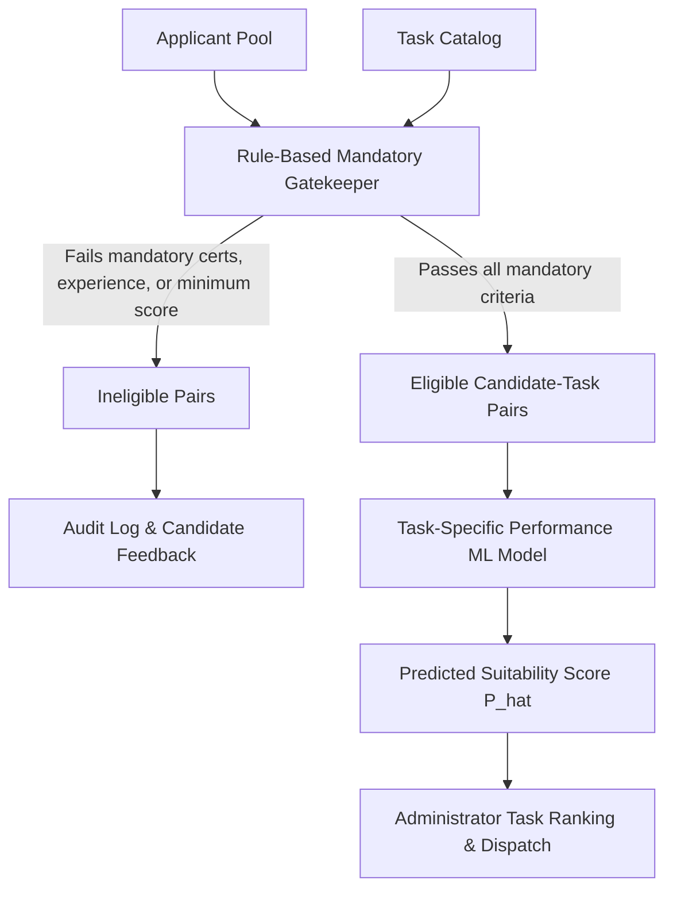

# VerifyMesh Task-Specific Performance Simulation Methodology

**Author:** Senior Machine Learning Engineer & Research Data Science Team  
**System:** VerifyMesh Prototype Task Suitability Modeling  
**Version:** 1.0 (Research Prototype)  
**Location:** `ml/experiments/task_specific_synthetic_data/`

---

## 1. Executive Research Integrity Statement

> [!IMPORTANT]
> **Synthetic Research Prototype Disclosure**
> 
> The outcomes in this dataset are **simulated using parametric stochastic equations**, not observed historical records of human work execution.
> 
> - Evaluation metrics (accuracy, ROC-AUC, F1-score) achieved by machine learning models trained on this data evaluate **only the algorithm's capacity to reverse-engineer the hypothesized data-generating function**.
> - High classification performance on this dataset **does not establish real-world predictive validity** or readiness for unmonitored automated hiring/dispatch decisions.
> - Genuine empirical validity would require rigorous, prospective collection of real workplace outcomes with informed consent, validated assessment rubrics, and formal algorithmic fairness audits.

---

## 2. Theoretical Motivation & System Decoupling

VerifyMesh operates on a two-phase allocation framework:

### Why a Relational Model is Required
The incumbent VerifyMesh classifier evaluates candidate general competency (an applicant-level binary classification: Eligible vs Not Eligible). However, workplace performance is fundamentally **relational**:
- A candidate possessing 90th-percentile Sales Negotiation skills and 36 months of sales experience will likely excel on an *Enterprise Outbound Pitching* task, yet struggle or fail on a *Developer API & Webhook Integration* task requiring high technical fluency and specialized technical certifications.
- An applicant cannot be labeled as universally "high-performing" across all tasks. Their probability of success depends on the interaction between candidate capabilities and task constraints.

---

## 3. Mandatory Rule-Based Eligibility Gate

Before evaluating task suitability, the system evaluates three deterministic prerequisites:

1. **Certification Requirement:**
   $$\text{cert\_satisfied} = \begin{cases} 1 & \text{if } \text{task.required\_cert} = \text{"None"} \lor \text{applicant holds } \text{task.required\_cert} \\ 0 & \text{otherwise} \end{cases}$$

2. **Tenure Requirement:**
   $$\text{experience\_surplus} = \text{task\_relevant\_experience} - \text{task.min\_relevant\_experience}$$
   $$\text{experience\_satisfied} = \mathbb{I}(\text{experience\_surplus} \ge 0)$$

3. **Core Assessment & Domain Competency Minimums:**
   $$\text{assessment\_satisfied} = \mathbb{I}(\Delta_{\text{assessment}} \ge 0 \land \Delta_{\text{comm}} \ge -5.0 \land \Delta_{\text{prod}} \ge -5.0 \land \Delta_{\text{domain}} \ge -3.0)$$

An applicant–task pair is eligible if and only if all three mandatory gates pass:
$$\text{is\_eligible} = \text{cert\_satisfied} \times \text{experience\_satisfied} \times \text{assessment\_satisfied}$$

If $\text{is\_eligible} = 0$, the exact failure modes are documented in `ineligibility_reasons` and quarantined from the ML training set.

---

## 4. Outcome-Generation Formulations: Two Simulation Scenarios

To avoid drawing empirical conclusions from a single arbitrary functional form, the data generator provides two distinct, configurable structural regimes.

### Scenario A: Balanced Compensatory Model (`scenario_a`, Default)

The Compensatory model assumes that candidate competencies can trade off against one another: exceptional domain skill can partially offset moderate experience deficits, and substantial domain tenure can offset minor assessment weaknesses.

#### 1. Log-Odds Index ($z_A$)
$$z_A = \beta_0 + \beta_{\text{skill}} \cdot \Omega + \beta_{\text{exp}} \cdot \tanh\left(\frac{\Delta_{\text{exp}}}{12}\right) + \gamma_{\text{cert}} - \beta_{\text{diff}} \cdot (\text{Tier} - 1) + \epsilon$$

Where:
- $\Omega = \sum_{k} w_{k} \cdot (\text{Score}_k - \text{Req}_k)$ is the domain-weighted skill margin across communication, product knowledge, sales skill, and customer service.
- $\Delta_{\text{exp}} = \text{Tenure}_{\text{relevant}} - \text{Tenure}_{\text{min}}$ represents tenure surplus in months.
- $\tanh\left(\frac{\Delta_{\text{exp}}}{12}\right)$ models diminishing marginal returns on experience: the leap from 0 to 12 months of surplus tenure yields substantial productivity gains, whereas the leap from 60 to 72 months yields negligible additional benefit.
- $\gamma_{\text{cert}} = +0.30$ if certified in domain, $-0.50$ if uncertified.
- $\text{Tier} \in \{1, 2, 3\}$ corresponds to Low, Medium, High task complexity.
- $\epsilon \sim \mathcal{N}(0, \sigma^2 = 0.45^2)$ captures unobserved ambient variance (e.g., unpredictable client demeanor, unexpected technical edge cases, sudden scope changes).

#### 2. Assumed Coefficients & Rationale

| Parameter | Value | Theoretical Rationale |
| :--- | :---: | :--- |
| $\beta_0$ | $-0.22$ | Intercept calibrated to yield an unconditioned baseline pass probability of $\approx 55\text{--}65\%$ for eligible candidates on average tasks. |
| $\beta_{\text{skill}}$ | $0.040$ | Each point of positive weighted skill surplus increases the log-odds of task success by $0.040$. A $+10$ point advantage increases odds of success by $e^{0.40} \approx 1.49\times$ ($+49\%$). |
| $\beta_{\text{exp}}$ | $0.55$ | Maximum logarithmic boost imparted by extensive tenure ($e^{0.55} \approx 1.73\times$). |
| $\beta_{\text{diff}}$ | $0.55$ | Each increment in task difficulty tier reduces log-odds by $0.55$, raising the competence necessary to achieve high success probability. |
| $\sigma_{\epsilon}$ | $0.45$ | Environmental stochastic disturbance preventing deterministic separation. |

#### 3. Bounded Success Probability & Bernoulli Outcome
$$P_A = \text{clip}\left(\frac{1}{1 + \exp(-z_A)}, 0.03, 0.97\right)$$
$$Y_i \sim \text{Bernoulli}(P_A)$$

Probabilities are bounded away from $\{0, 1\}$ to reflect that even the most qualified professional has a small non-zero failure risk (e.g. severe infrastructure outage), and an underdog candidate has a non-zero chance of lucky success.

---

### Scenario B: Strict Bottleneck / High-Stakes Model (`scenario_b`)

Scenario B formalizes a "Weakest-Link" (Leaky-Bucket / O-Ring) theory of workplace execution. In complex, high-stakes tasks, high performance across three skills cannot rescue an assignment if the applicant suffers from a catastrophic deficit in a fourth critical skill.

#### 1. Log-Odds Index ($z_B$)
$$z_B = \beta_0 + \beta_{\text{skill}} \cdot \Omega + \beta_{\text{min}} \cdot M_{\text{min}} + \beta_{\text{exp}} \cdot \ln(1 + \max(0, \Delta_{\text{exp}})) + \gamma_{\text{cert}} - \Psi_{\text{bottleneck}} - \beta_{\text{diff}} \cdot (\text{Tier})^{1.35} + \epsilon_{\text{logistic}}$$

Where:
- $M_{\text{min}} = \min_k(\text{Score}_k - \text{Req}_k)$ is the applicant's lowest margin across all competency dimensions.
- $\Psi_{\text{bottleneck}} = 0.045 \cdot |M_{\text{min}}|^{1.15} \cdot \mathbb{I}(M_{\text{min}} < 0)$ applies an escalating non-linear penalty if any critical skill is below the task threshold.
- $(\text{Tier})^{1.35}$ imposes super-linear difficulty scaling: Tier-3 tasks are disproportionately punishing.
- $\epsilon_{\text{logistic}} \sim \text{Logistic}(0, s = 0.40)$ introduces heavier tails to simulate occasional catastrophic errors or breakthrough performances.

#### 2. Assumed Coefficients

| Parameter | Value | Theoretical Rationale |
| :--- | :---: | :--- |
| $\beta_0$ | $-0.15$ | Intercept calibrated for high-stakes task distribution. |
| $\beta_{\text{skill}}$ | $0.028$ | Base domain skill contribution. |
| $\beta_{\text{min}}$ | $0.035$ | Specific reward/penalty for the weakest competency dimension. |
| $\beta_{\text{exp}}$ | $0.28$ | Logarithmic tenure growth. |
| $\Psi_{\text{bottleneck}}$ | $0.045 \cdot |M|^{1.15}$ | Punitive penalty for deficits on any required competency. |
| $\beta_{\text{diff}}$ | $0.40$ | Base difficulty multiplier with exponent $1.35$. |

#### 3. Bounded Probability
$$P_B = \text{clip}\left(\frac{1}{1 + \exp(-z_B)}, 0.02, 0.98\right)$$
$$Y_i \sim \text{Bernoulli}(P_B)$$

---

## 5. Prevention of Target Leakage

To preserve experimental integrity and prevent spurious model accuracy:

1. **Quarantined Latents:** `latent_score` and `latent_success_prob` are explicitly dropped prior to outputting `task_suitability_training.csv`.
2. **Quarantined Identifiers:** `applicant_id` and `task_id` are excluded to force the model to learn generalizable relational representations rather than memorizing individual agent or task IDs.
3. **Quarantined Gatekeeper Columns:** `is_eligible` and `ineligibility_reasons` are excluded from the training dataset. Because the training set is filtered to $\text{is\_eligible} == 1$, retaining this column would be a degenerate zero-variance feature.
4. **No Post-Hoc Features:** Features such as "task resolution duration", "client post-call rating", or "historical task success rate" are omitted. Only pre-assignment telemetry is provided as inputs.

---

## 6. Known Limitations of the Simulation

1. **Parametric Assumption Bias:** Because outcomes are generated via logistic response curves, generalized linear models or neural networks with sigmoid activations may exhibit unnaturally high goodness-of-fit.
2. **Omission of Temporal Dynamics:** Real worker performance exhibits time-series effects (learning curves, fatigue, burnout, seasonal demand surges), which are omitted from this cross-sectional snapshot.
3. **Independence of Applications:** Pairs are sampled with stratified domain affinity, but in a production marketplace, applicants strategically apply to tasks based on pay rates, perceived difficulty, and competing applicants.
4. **Absence of Subjective Bias:** Real human evaluations and supervisor ratings often carry interpersonal or unconscious bias, which is not present in our objective mathematical simulation.

---

## 7. Recommended Next Steps for Research

1. **Model Comparison Benchmark:** Train and benchmark baseline algorithms on `task_suitability_training.csv`:
   - Baseline 1: Majority Class Dummy Classifier
   - Baseline 2: L2-Regularized Logistic Regression
   - Baseline 3: Random Forest Classifier
   - Baseline 4: Gradient Boosting (XGBoost / LightGBM)
2. **Cross-Scenario Generalization Test:** Train a model on Scenario A data and test out-of-distribution on Scenario B data to evaluate model sensitivity to structural assumptions.
3. **Threshold Calibration:** Evaluate decision curves across classification thresholds $\tau \in [0.40, 0.70]$ to trade off False Positives (assigning a candidate who fails) versus False Negatives (leaving a task unfilled).
